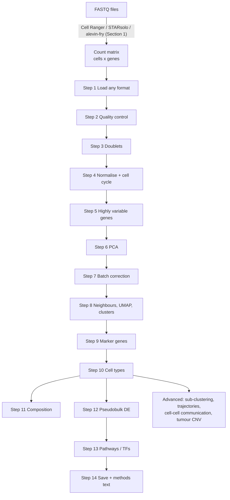

# Single-Cell RNA-seq Analysis: Universal Master Guide

**By Akbar Ali** · Universiti Sains Malaysia · Version 1.0 · 31 October 2026

A complete, step-by-step pipeline for single-cell data in Python (Scanpy). It is written to work on almost any
single-cell dataset: 10x Chromium, snRNA-seq, CITE-seq, BD Rhapsody, Parse, Smart-seq2, public GEO tables and
`.h5ad` files, from human, mouse or other species. Every step gives **the code**, **what it does in plain
English**, **what to look at**, and **when to change the default**.

> **Prefer R?** The same pipeline, with the same steps, settings and output names, is in
> [Single_Cell_Master_Guide_R.md](Single_Cell_Master_Guide_R.md) (Seurat v5 + Bioconductor). Its Section 0
> explains when to choose R or Python.

> **Tested.** Every core code block in this guide was run, top to bottom, on public datasets with the package
> versions in `environment.yml` (see [Section 25](#25-how-this-guide-was-tested)). Blocks marked
> *untested here* need software or data that were not available on the test machine; they follow the tools'
> own documentation but you should expect to check them against that documentation.

---

## Contents

0. [Read this first](#0-read-this-first)
1. [From sequencer to count matrix](#1-from-sequencer-to-count-matrix)
2. [Install the software (once)](#2-install-the-software-once)
3. [Organise your project](#3-organise-your-project)
4. [Step 0: Settings](#4-step-0-settings)
5. [Step 1: Load the data (any format)](#5-step-1-load-the-data-any-format)
6. [Step 2: Quality control](#6-step-2-quality-control)
7. [Step 3: Doublets and ambient RNA](#7-step-3-doublets-and-ambient-rna)
8. [Step 4: Normalisation and cell cycle](#8-step-4-normalisation-and-cell-cycle)
9. [Step 5: Highly variable genes](#9-step-5-highly-variable-genes)
10. [Step 6: PCA](#10-step-6-pca)
11. [Step 7: Batch correction (integration)](#11-step-7-batch-correction-integration)
12. [Step 8: Neighbours, UMAP and clustering](#12-step-8-neighbours-umap-and-clustering)
13. [Step 9: Marker genes](#13-step-9-marker-genes)
14. [Step 10: Cell-type annotation](#14-step-10-cell-type-annotation)
15. [Step 11: Cell-type composition](#15-step-11-cell-type-composition)
16. [Step 12: Differential expression (pseudobulk)](#16-step-12-differential-expression-pseudobulk)
17. [Step 13: Pathways and transcription factors](#17-step-13-pathways-and-transcription-factors)
18. [Step 14: Save, export and write the methods](#18-step-14-save-export-and-write-the-methods)
19. [Advanced modules](#19-advanced-modules)
20. [Other data types](#20-other-data-types)
21. [Working with R and Seurat](#21-working-with-r-and-seurat)
22. [Troubleshooting](#22-troubleshooting)
23. [Checklist before you publish](#23-checklist-before-you-publish)
24. [References](#24-references)
25. [How this guide was tested](#25-how-this-guide-was-tested)

---

## 0. Read this first

### 0.1 The whole pipeline on one page



### 0.2 What "universal" means here

You change **settings**, not code. The table shows what each kind of data needs.

| Your data | What you do differently | Where |
|---|---|---|
| 10x Chromium 3' or 5' scRNA-seq | Nothing. This is the default path. | Steps 0-14 |
| Single-nucleus RNA-seq (snRNA-seq) | `MATERIAL = "nuclei"` (stricter mitochondrial cut-off, mito genes removed) | [20.1](#201-single-nucleus-rna-seq-snrna-seq) |
| CITE-seq (RNA + surface proteins) | Nothing to load: proteins go to `adata.obsm["antibody_capture"]` automatically | [20.2](#202-cite-seq-rna--protein) |
| Multiome / scATAC-seq | RNA part runs here; ATAC part with SnapATAC2 or muon | [20.3](#203-scatac-seq-and-multiome) |
| Spatial (Visium, Xenium, CosMx, MERFISH) | Same QC/clustering ideas, plus Squidpy | [20.4](#204-spatial-transcriptomics) |
| Smart-seq2 / plate-based full-length | No UMIs; round estimated counts | [20.5](#205-smart-seq2-and-other-plate-based-full-length-data) |
| BD Rhapsody, Parse, Drop-seq, ScaleBio, Singleron | Point `SAMPLES` at their matrix (mtx, csv or h5ad) | Step 1 |
| Public GEO tables (CSV / TSV / TXT) | Nothing: orientation (genes x cells or cells x genes) is detected | Step 1 |
| Public `.h5ad` (CELLxGENE, papers) | Nothing: raw counts are found in `layers`/`.raw`; Ensembl IDs become symbols | Step 1 |
| Only normalised data available | Nothing: count-based steps are skipped or replaced automatically | Steps 1, 3, 4, 12 |
| Seurat `.rds` object | Convert to `.h5ad` in R first (one command) | [21](#21-working-with-r-and-seurat) |
| Mouse or another species | `SPECIES`; gene matching is case-blind (CD3E = Cd3e) | Step 2 |
| TCR / BCR repertoire | Scirpy | [20.6](#206-tcr--bcr-repertoire) |
| Hashtag or genotype multiplexing | Demultiplex first | [20.7](#207-multiplexed-samples-hashtags-or-genotypes) |

### 0.3 How to read the code blocks

* **Core `python` blocks**: run them in order, top to bottom. The easiest way is one block per cell in
  Jupyter Lab. Nothing in a later block works if an earlier block was skipped.
* **Blocks that start with `# OPTIONAL`**: run them only if you need that analysis. The core pipeline never
  depends on them.
* **`bash` blocks** go in the Terminal; **`r` blocks** go in R / RStudio.
* All figures go to `figures/`, all tables to `tables/`, saved objects to `objects/` inside your project
  folder, so you never lose a result by closing Jupyter.

### 0.4 Six golden rules

1. **Never throw away the raw counts.** They are stored in `adata.layers["counts"]`; differential expression
   needs them.
2. **The unit of replication is the sample (patient, animal), not the cell.** 10,000 cells from one patient
   is *n = 1*. Statistics between conditions must count samples.
3. **QC every sample on its own terms.** One fixed cut-off for all samples throws away good cells in one
   sample and keeps bad cells in another. This guide uses per-sample adaptive limits (MADs).
4. **Compare conditions with pseudobulk**, never with a cell-by-cell test. Cell-level tests give thousands of
   false "significant" genes (Squair et al. 2021).
5. **A cluster is not a cell type until its marker genes say so.** Always look at the markers before you
   name anything.
6. **Write down every parameter.** The pipeline does it for you: `tables/run_settings.json` and
   `tables/software_versions.csv`.

### 0.5 Key words in plain English

| Word | Meaning |
|---|---|
| **Barcode** | A short DNA tag that marks which droplet (cell) a read came from. |
| **UMI** | Unique Molecular Identifier: a tag on each original mRNA molecule, so PCR copies are counted once. |
| **Count matrix** | A table: one row per cell, one column per gene, each value = how many mRNA molecules were counted. |
| **AnnData** (`adata`) | The Python object that holds the matrix *and* everything about it (picture below). |
| **QC** | Quality control: removing broken cells, empty droplets and doublets. |
| **MAD** | Median absolute deviation: a robust measure of spread. "5 MADs from the median" = clearly unusual. |
| **Doublet** | Two cells caught in one droplet; it looks like a strange "hybrid" cell. |
| **Ambient RNA** | Free-floating mRNA from broken cells that contaminates every droplet ("soup"). |
| **Normalisation** | Making cells comparable when some were sequenced more deeply than others. |
| **HVG** | Highly variable genes: the ~2,000 genes that differ most between cells and carry the biology. |
| **PCA** | Compresses 2,000 genes into ~30 summary axes (principal components). |
| **Batch effect** | Technical differences between samples or runs that are not biology. |
| **kNN graph** | Each cell connected to its ~15 most similar cells. Clustering and UMAP use this graph. |
| **UMAP** | A 2-D picture of the kNN graph. Good for looking, *not* for measuring distances. |
| **Leiden** | The clustering algorithm: finds groups of cells that are more connected to each other than to others. |
| **Resolution** | Leiden setting: higher = more, smaller clusters. |
| **Marker gene** | A gene much higher in one cluster than in all others. |
| **Pseudobulk** | Adding up the counts of all cells of one type in one sample, giving one "bulk RNA-seq" profile per sample. |

The AnnData object, which every step reads and writes:

```text
                    adata.var  (one row per GENE: name, is_mito, highly_variable, ...)
                  ┌───────────────────────────────────────┐
  adata.obs       │ adata.X           log-normalised values│   adata.obsm  (per-cell tables)
  (one row per    │ adata.layers["counts"]   raw counts    │     X_pca, X_pca_harmony, X_umap,
   CELL: sample,  │                                         │     antibody_capture (CITE-seq) ...
   QC, cluster,   │          cells  x  genes                │
   cell_type ...) └───────────────────────────────────────┘
                    adata.uns  (everything else: colours, marker results, ...)
```

---

## 1. From sequencer to count matrix

The sequencer gives **FASTQ** files. A "pre-processing" tool reads them, works out which cell (barcode) and
which molecule (UMI) each read belongs to, maps it to a gene, and writes the **count matrix**. This guide
starts from that matrix. If someone already gave you the matrix (core facility, GEO), skip to Section 2.

| Tool | Use it for | Notes |
|---|---|---|
| **Cell Ranger** (10x Genomics) | 10x Chromium data | Official, standard in papers. Runs on Linux only (use a server/HPC). |
| **STARsolo** | Any droplet technology, fast | Free; output matches Cell Ranger closely; also gives velocity counts. |
| **alevin-fry / simpleaf** | Any droplet technology, low memory | Free; fast. |
| **kallisto \| bustools** | Any droplet technology, very fast | Pseudo-alignment. |
| **BD Rhapsody pipeline / Parse split-pipe** | Their own kits | Produce mtx/csv matrices this guide can read. |
| **STAR + featureCounts, or salmon** | Smart-seq2 / plate data | One count column per cell. |

*Untested here (needs Linux, FASTQ files and a genome reference).* Typical commands:

```bash
# 10x Genomics Cell Ranger (one sample). Introns are counted by default from version 7,
# which is what you want for snRNA-seq.
cellranger count --id=P01_tumour \
    --transcriptome=/refs/refdata-gex-GRCh38-2024-A \
    --fastqs=/data/fastq --sample=P01_tumour \
    --create-bam=true --localcores=16 --localmem=64

# STARsolo for 10x 3' v3 (16 bp barcode + 12 bp UMI). The cDNA read (R2) comes FIRST, the barcode read (R1) second.
STAR --runThreadN 16 --genomeDir /refs/star_GRCh38 \
     --readFilesIn P01_R2.fastq.gz P01_R1.fastq.gz --readFilesCommand zcat \
     --soloType CB_UMI_Simple --soloCBwhitelist 3M-february-2018.txt --soloUMIlen 12 \
     --soloFeatures Gene GeneFull Velocyto --soloCellFilter EmptyDrops_CR \
     --outSAMtype None --outFileNamePrefix P01/
# For nuclei use the GeneFull matrix (counts intronic reads): P01/Solo.out/GeneFull/filtered/
```

**Which output file do I use?**

* `filtered_feature_bc_matrix` (folder) or `filtered_feature_bc_matrix.h5`: only barcodes called as cells.
  **Use this for this guide.**
* `raw_feature_bc_matrix`: every barcode, including empty droplets. Needed only for ambient-RNA removal
  (CellBender, SoupX; Section 7).

---

## 2. Install the software (once)

You need **Miniforge** (a small conda installer: <https://github.com/conda-forge/miniforge>). Then, in the
Terminal, inside this repository folder:

```bash
conda env create -f environment.yml      # creates an environment called "scanalysis" (5-10 minutes)
conda activate scanalysis
python -m ipykernel install --user --name scanalysis --display-name "Python (scanalysis)"
jupyter lab                               # opens Jupyter in your browser
```

In Jupyter choose the kernel **"Python (scanalysis)"**, then copy the blocks below into cells one by one.

Without the file, the same environment can be built by hand:

```bash
conda create -n scanalysis -c conda-forge python=3.11 -y
conda activate scanalysis
pip install "scanpy[leiden]" "pynndescent<0.7" scikit-misc scikit-image harmonypy pydeseq2 decoupler celltypist liana loompy jupyterlab seaborn
```

> **Why `pynndescent<0.7`?** pynndescent 0.7 (2026) returns a newer sparse-matrix type that scanpy 1.11.5
> cannot read. Scanpy uses pynndescent for the neighbour graph whenever a dataset has more than 8,192 cells, so
> with 0.7 every large dataset crashes at Step 8. Small test data never show this; a 100,000-cell breast
> cancer atlas did (Section 25). Step 1 warns you if the wrong version is installed.

*What each package does:* **scanpy** (the core toolkit) · **anndata** (the data object) · **leidenalg / igraph**
(clustering) · **scikit-misc** (needed for the Seurat-v3 highly-variable-gene method) · **scikit-image**
(needed by Scrublet to choose its doublet threshold automatically) · **harmonypy** (batch
correction) · **pydeseq2** (DESeq2 for pseudobulk) · **decoupler** (pathway and transcription-factor
activity) · **celltypist** (automatic cell-type labels) · **liana** (cell-cell communication) · **loompy**
(reads `.loom` files) · **seaborn** (plots).

*Computer size:* a laptop with 16 GB RAM handles ~50,000-100,000 cells. For more, use a workstation or server
(memory, not speed, is the usual limit).

---

## 3. Organise your project

Keep every project in its own folder. The pipeline creates `figures/`, `tables/` and `objects/` itself.

```text
my_sc_project/
├── data/                      <- your input files (never edited)
│   ├── P01_tumour/filtered_feature_bc_matrix/
│   ├── P01_normal/filtered_feature_bc_matrix.h5
│   └── sample_sheet.csv
├── analysis.ipynb             <- your notebook with the blocks from this guide
├── figures/                   <- created by the pipeline
├── tables/                    <- created by the pipeline
└── objects/                   <- saved AnnData files (.h5ad)
```

A **sample sheet** is a small CSV with one row per sample. The first column must be the sample name exactly as
in `SAMPLES` (Step 0). Add any columns you like: they become columns of `adata.obs`.

```text
sample,condition,patient,batch,age
P01_tumour,tumour,P01,run1,54
P01_normal,normal,P01,run1,54
P02_tumour,tumour,P02,run2,61
P02_normal,normal,P02,run2,61
```

---

## 4. Step 0: Settings

**This is the only block you must edit.** Everything later reads these names. Every setting is explained in
the comment next to it and again in the step that uses it.

```python
# ===== STEP 0 · SETTINGS: the only block you need to edit =====
from pathlib import Path

PROJECT_DIR = Path.home() / "Desktop" / "my_sc_project"    # results are written here

# One entry per sample:  "sample name": "path to its data"  (absolute, or relative to PROJECT_DIR).
# Formats: 10x folder, 10x .h5, .h5ad, .loom, .zarr, (prefix_)matrix.mtx(.gz),
#          .csv / .tsv / .txt (.gz) count tables (genes x cells OR cells x genes: detected automatically)
SAMPLES = {
    "P01_tumour": "data/P01_tumour/filtered_feature_bc_matrix",
    "P01_normal": "data/P01_normal/filtered_feature_bc_matrix.h5",
}
SAMPLE_COL   = None       # one file holding MANY samples? name its obs column that says which sample (else None)
SAMPLE_SHEET = None       # optional CSV, one row per sample, first column = sample name (e.g. "data/sample_sheet.csv")

SPECIES  = "human"        # "human" or "mouse" (used for CellTypist / pathway resources)
MATERIAL = "cells"        # "cells" (scRNA-seq) or "nuclei" (snRNA-seq)

# --- Quality control (Step 2) ---
MIN_GENES  = 200          # a cell must express at least this many genes
NMADS      = 5            # outlier = more than 5 MADs from ITS OWN sample's median (counts, genes, top-20 share)
MT_NMADS   = 3            # stricter for mitochondrial %
MAX_PCT_MT = 20 if MATERIAL == "cells" else 5     # hard ceiling on mitochondrial % (see Step 2 for tissues)
MIN_CELLS_PER_GENE = 3    # drop genes detected in fewer cells than this

# --- Main analysis (Steps 5-8) ---
BATCH_KEY   = "sample"    # what to correct for: "sample", "patient", "batch" ... ; None = no correction
N_HVG       = 2000        # number of highly variable genes
N_PCS       = 30          # principal components used downstream (check the elbow plot in Step 6)
N_NEIGHBORS = 15          # neighbours per cell in the kNN graph
RESOLUTIONS = [0.2, 0.4, 0.6, 0.8, 1.0, 1.5]       # Leiden resolutions to try
RESOLUTION  = 0.6         # the one you keep (decide after looking at Step 8)

# --- Comparing conditions (Steps 11-12). Leave CONDITION_KEY = None to skip ---
CONDITION_KEY = None      # obs column with the groups, e.g. "condition"
CONTRAST      = None      # (test group, reference group), e.g. ("tumour", "normal")
REPLICATE_KEY = "sample"  # the biological replicate: one value per patient/animal/sample
DE_COVARIATES = []        # e.g. ["patient"] when tumour and normal come from the same patients (paired design)
MIN_CELLS_PSEUDOBULK = 10 # a cell type needs at least this many cells in a sample to enter DE

SEED = 0                  # random seed: same seed + same data + same versions = same result
```

---

## 5. Step 1: Load the data (any format)

### 5.1 Libraries and helper functions

**What it does.** Loads the Python libraries, creates the output folders, sets figure quality, and defines two
small helpers: `save()` (saves the current figure as a 300-dpi PNG) and `genes_present()` (finds genes in your
data whatever the capital letters are, so human `CD3E` also finds mouse `Cd3e`).

```python
import json, re, sys, warnings
import numpy as np
import pandas as pd
import scipy.sparse as sp
import scanpy as sc
import anndata as ad
import matplotlib.pyplot as plt
from scipy.stats import median_abs_deviation

FIG, TAB, OBJ = (PROJECT_DIR / d for d in ("figures", "tables", "objects"))
for d in (FIG, TAB, OBJ):
    d.mkdir(parents=True, exist_ok=True)

sc.settings.verbosity = 2                      # 0 = errors only ... 4 = everything
sc.settings.set_figure_params(dpi=100, dpi_save=300, frameon=False, vector_friendly=True)
np.random.seed(SEED)


def save(name):
    """Save the current figure as figures/<name>.png, show it (in Jupyter), then close it."""
    plt.savefig(FIG / f"{name}.png", dpi=300, bbox_inches="tight")
    plt.show()
    plt.close("all")


def genes_present(adata, genes):
    """The genes from `genes` that exist in the data, matched case-blind, in the data's own spelling."""
    lookup = {g.upper(): g for g in adata.var_names}
    return [lookup[g.upper()] for g in genes if g.upper() in lookup]


sc.logging.print_header()                      # prints the versions of the main packages

from importlib.metadata import version as _pkg_version
if tuple(int(x) for x in _pkg_version("pynndescent").split(".")[:2]) >= (0, 7):
    warnings.warn("pynndescent >= 0.7 is installed: scanpy 1.11.5 then crashes on datasets with more than 8,192 "
                  "cells (Step 8). Fix: pip install 'pynndescent<0.7' (see Section 2).")
```

### 5.2 The universal reader

**What it does.** `read_any(path)` looks at the file or folder and picks the right way to read it:

| You give it | It does |
|---|---|
| A folder with `matrix.mtx(.gz)` + `features.tsv`/`genes.tsv` + `barcodes.tsv` | Reads the 10x / STARsolo / GEO matrix (gzipped or not). Works out if the matrix is genes x cells or cells x genes. |
| A Cell Ranger / STARsolo output folder | Finds `filtered_feature_bc_matrix(.h5)` or `Solo.out/Gene/filtered` inside it. |
| `GSM123_matrix.mtx.gz` (GEO style, with a prefix) | Finds `GSM123_features.tsv.gz` / `GSM123_genes.tsv.gz` and `GSM123_barcodes.tsv.gz` next to it. |
| `.h5` | Cell Ranger / Space Ranger / CellBender HDF5. |
| `.h5ad` | AnnData. If `X` is normalised, it looks for raw counts in `layers` (preferring a name with "count") or in `.raw`. |
| `.loom`, `.zarr` | Read directly. |
| `.csv`, `.tsv`, `.txt` (also `.gz`) | Reads the table and decides from the row/column names which side is genes. |
| `.rds` (Seurat) | Stops and tells you how to convert it (Section 21). |

After reading it also (a) makes gene names unique, (b) switches Ensembl IDs (`ENSG000...`) to gene symbols
when a symbol column exists, and (c) moves non-RNA features (CITE-seq antibodies, hashtags, CRISPR guides) out
of the gene matrix into `adata.obsm`, so they do not disturb the RNA analysis.

```python
# ---- Universal reader: turns (almost) any single-cell file into an AnnData object (cells x genes) ----
import scipy.io

GENE_HINTS = {"ACTB", "GAPDH", "B2M", "MALAT1", "EEF1A1", "TMSB4X", "FTL", "FTH1", "RPLP0", "MT-CO1"}
SYMBOL_COLUMNS = ("gene_symbols", "gene_symbol", "gene_name", "gene_names", "feature_name", "symbol", "name")


def looks_like_counts(X, n=2000):
    """True if the values are raw counts: whole numbers and never negative."""
    sub = X[: min(n, X.shape[0])]
    vals = sub.data if sp.issparse(sub) else np.asarray(sub).ravel()
    return vals.size == 0 or (vals.min() >= 0 and np.allclose(vals, np.round(vals)))


def data_state(X):
    """'counts', 'log' (already log-normalised) or 'normalised' (e.g. TPM/CPM, not logged)."""
    if looks_like_counts(X):
        return "counts"
    sub = X[:2000]
    vals = sub.data if sp.issparse(sub) else np.asarray(sub).ravel()
    if vals.min() < 0:
        raise ValueError("Negative values: these data are scaled/z-scored. Find the raw counts (Section 22).")
    return "log" if vals.max() < 50 else "normalised"


def _gene_like(labels):
    """How many labels look like gene symbols or Ensembl gene IDs."""
    up = pd.Index(labels).astype(str).str.upper()
    return int(up.isin(GENE_HINTS).sum() + up.str.match(r"^ENS[A-Z]*G\d{6,}").sum())


def _first(folder, names):
    """The first of `names` that exists inside `folder`, else None."""
    return next((folder / n for n in names if (folder / n).exists()), None)


def _read_mtx(folder, prefix=""):
    """matrix.mtx + features.tsv/genes.tsv + barcodes.tsv (10x, STARsolo, GEO; gzipped or not)."""
    mtx = _first(folder, [prefix + n for n in ("matrix.mtx.gz", "matrix.mtx")])
    feat = _first(folder, [prefix + n for n in ("features.tsv.gz", "features.tsv", "genes.tsv.gz", "genes.tsv")])
    bcs = _first(folder, [prefix + n for n in ("barcodes.tsv.gz", "barcodes.tsv")])
    if not (mtx and feat and bcs):
        raise FileNotFoundError(f"{folder}: need {prefix}matrix.mtx, {prefix}features.tsv (or genes.tsv) "
                                f"and {prefix}barcodes.tsv")
    X = sp.csr_matrix(scipy.io.mmread(mtx), dtype=np.float32)
    feat = pd.read_csv(feat, sep="\t", header=None, dtype=str)
    bcs = pd.read_csv(bcs, sep="\t", header=None, dtype=str)[0]
    if X.shape == (len(feat), len(bcs)):          # the usual layout is genes x cells: turn it round
        X = X.T.tocsr()
    elif X.shape != (len(bcs), len(feat)):
        raise ValueError(f"matrix is {X.shape} but there are {len(bcs)} barcodes and {len(feat)} features")
    var = pd.DataFrame({"gene_ids": feat[0].values})
    var.index = (feat[1] if feat.shape[1] > 1 else feat[0]).values
    if feat.shape[1] > 2:
        var["feature_types"] = feat[2].values
    return ad.AnnData(X=X, obs=pd.DataFrame(index=bcs.values), var=var)


def _read_table(path, genes_are_rows=None):
    """A count table in CSV / TSV / TXT (optionally .gz), as often shared on GEO."""
    sep = "," if ".csv" in path.name.lower() else "\t"
    df = pd.read_csv(path, sep=sep)
    if df.shape[1] == 1:                                    # neither comma nor tab: split on any whitespace
        df = pd.read_csv(path, sep=r"\s+")
    first = df.columns[0]
    if str(first).startswith("Unnamed") or not pd.api.types.is_numeric_dtype(df[first]):
        df = df.set_index(first)                            # first column = gene (or cell) names
    text = [c for c in df.columns if not pd.api.types.is_numeric_dtype(df[c])]
    extra, df = df[text], df.drop(columns=text)             # e.g. a gene-description column
    if genes_are_rows is None:                              # GEO tables are usually genes x cells
        genes_are_rows = _gene_like(df.index) >= _gene_like(df.columns)
    if genes_are_rows:
        df, obs, var = df.T, pd.DataFrame(index=df.columns), extra
    else:
        obs, var = extra, pd.DataFrame(index=df.columns)
    X = sp.csr_matrix(df.to_numpy(dtype=np.float32))
    return ad.AnnData(X=X, obs=obs.set_axis(obs.index.astype(str)), var=var.set_axis(var.index.astype(str)))


def _read_h5ad(path):
    """An .h5ad file. Finds the raw counts even when X holds normalised values."""
    a = sc.read_h5ad(path)
    if not looks_like_counts(a.X):
        found = sorted((k for k in a.layers if looks_like_counts(a.layers[k])), key=lambda k: "count" not in k.lower())
        if found:
            print(f"  X is not raw counts; using layers['{found[0]}']")
            a.X = a.layers[found[0]].copy()
        elif a.raw is not None and looks_like_counts(a.raw.X):
            print("  X is not raw counts; using .raw")
            a = a.raw.to_adata()
    for k in list(a.layers):                                 # the pipeline makes its own layers
        del a.layers[k]
    a.raw = None
    return a


def _use_gene_symbols(a):
    """If genes are Ensembl IDs and a symbol column exists, switch to symbols (IDs kept in var['gene_ids'])."""
    if pd.Index(a.var_names).str.match(r"^ENS[A-Z]*G\d{6,}").mean() < 0.5:
        return a
    col = next((c for c in SYMBOL_COLUMNS if c in a.var.columns), None)
    if col is None:
        print("  NOTE: genes are Ensembl IDs and no symbol column was found; mitochondrial genes and marker "
              "lists will not match (see Section 22).")
        return a
    symbols = a.var[col].astype(str)
    ok = ~symbols.isin(["", "nan", "None"])
    a.var["gene_ids"] = a.var_names
    a.var_names = np.where(ok, symbols, a.var_names)
    a.var_names_make_unique()
    return a


def _split_modalities(a):
    """Keep RNA in X; move antibody (CITE-seq / hashtag) and CRISPR-guide counts to a.obsm."""
    if "feature_types" not in a.var.columns:
        return a
    ftype = a.var["feature_types"].astype(str)
    if "Gene Expression" not in set(ftype):
        return a
    for t in ftype[ftype != "Gene Expression"].unique():
        m = (ftype == t).to_numpy()
        if t == "Peaks":
            print(f"  {m.sum():,} ATAC peaks left out (analyse ATAC separately, Section 20.3)")
            continue
        key = re.sub(r"\W+", "_", t.lower())              # 'Antibody Capture' -> 'antibody_capture'
        vals = a[:, m].X
        vals = vals.toarray() if sp.issparse(vals) else np.asarray(vals)
        a.obsm[key] = pd.DataFrame(vals, index=a.obs_names, columns=a.var_names[m])
        print(f"  {m.sum()} '{t}' features moved to adata.obsm['{key}']")
    return a[:, (ftype == "Gene Expression").to_numpy()].copy()


def read_any(path, genes_are_rows=None):
    """Read one sample (or one multi-sample file) in any common single-cell format."""
    path = Path(path).expanduser()
    if not path.is_absolute():
        path = PROJECT_DIR / path
    if not path.exists():
        raise FileNotFoundError(path)
    name = path.name.lower()

    if name.endswith(".zarr"):
        a = ad.read_zarr(path)
    elif path.is_dir():
        if _first(path, ["matrix.mtx.gz", "matrix.mtx"]):
            a = _read_mtx(path)
        else:                                             # Cell Ranger / STARsolo output folders
            for sub in ("filtered_feature_bc_matrix.h5", "outs/filtered_feature_bc_matrix.h5",
                        "sample_filtered_feature_bc_matrix.h5", "filtered_feature_bc_matrix",
                        "outs/filtered_feature_bc_matrix", "Solo.out/Gene/filtered", "Gene/filtered"):
                if (path / sub).exists():
                    return read_any(path / sub, genes_are_rows)
            raise FileNotFoundError(f"{path}: no matrix.mtx or filtered_feature_bc_matrix inside")
    elif name.endswith(".h5ad"):
        a = _read_h5ad(path)
    elif name.endswith(".h5"):
        a = sc.read_10x_h5(path, gex_only=False)          # Cell Ranger, Space Ranger, CellBender
    elif name.endswith(".loom"):
        a = sc.read_loom(path, sparse=True)               # velocyto style: genes in 'Gene', cells in 'CellID'
        if "var_names" in a.var.columns:                  # written by anndata: names are stored under other keys
            a.var_names = a.var.pop("var_names").astype(str).values
        if "obs_names" in a.obs.columns:
            a.obs_names = a.obs.pop("obs_names").astype(str).values
    elif re.search(r"matrix\.mtx(\.gz)?$", name):         # GEO style: GSM123_matrix.mtx.gz + GSM123_barcodes...
        a = _read_mtx(path.parent, prefix=path.name[: name.rindex("matrix.mtx")])
    elif re.search(r"\.(csv|tsv|txt)(\.gz)?$", name):
        a = _read_table(path, genes_are_rows)
    elif re.search(r"\.(rds|rdata|rda)$", name):
        raise ValueError(f"{path.name} is an R object: convert it to .h5ad first (Section 21).")
    else:
        raise ValueError(f"Unknown format: {path.name}")

    a.var_names_make_unique()
    a = _use_gene_symbols(a)
    a = _split_modalities(a)
    if not sp.issparse(a.X):
        a.X = sp.csr_matrix(a.X)
    return a
```

### 5.3 Load every sample and merge

**What it does.** Reads each entry of `SAMPLES`, labels every cell with its sample, gives each cell a unique
name (`sample_barcode`), and joins all samples into one object. Only genes measured in **every** sample are
kept (the "inner join"), and the code tells you how many were dropped. It then adds the sample-sheet columns,
checks whether the values are raw counts, and checks that every column you named in Step 0 really exists.

**What to look at in the print-out.**
* Cells per sample: roughly what the lab expected (often 1,000-10,000 per 10x sample)? Far more (> 50,000)
  usually means you loaded the *raw* matrix with empty droplets: use the *filtered* one.
* Genes: ~20,000-36,000 for a full human/mouse reference.
* `data = counts` is what you want. `log` or `normalised` means only processed values were available: the
  pipeline still runs but skips count-based steps (Scrublet, Seurat-v3 HVGs, pseudobulk DE).

```python
adatas = []
for name, path in SAMPLES.items():
    print(f"Reading {name} ...")
    a = read_any(path)
    a.obs["sample"] = a.obs[SAMPLE_COL].astype(str).values if SAMPLE_COL else name
    a.obs_names = name + "_" + a.obs_names.astype(str)        # unique cell names across samples
    print(f"  {a.n_obs:,} cells x {a.n_vars:,} genes")
    adatas.append(a)

all_genes = set().union(*(a.var_names for a in adatas))
all_obsm = set().union(*(a.obsm.keys() for a in adatas))
adata = ad.concat(adatas, join="inner", merge="same") if len(adatas) > 1 else adatas[0]
del adatas
if len(all_genes) > adata.n_vars:
    print(f"NOTE: {len(all_genes) - adata.n_vars:,} genes were not measured in every sample and were dropped.")
if all_obsm - set(adata.obsm.keys()):
    print(f"NOTE: {sorted(all_obsm - set(adata.obsm.keys()))} not present in every sample, so dropped.")
adata.X = sp.csr_matrix(adata.X, dtype=np.float32)

if SAMPLE_SHEET:
    sheet_path = Path(SAMPLE_SHEET) if Path(SAMPLE_SHEET).is_absolute() else PROJECT_DIR / SAMPLE_SHEET
    sheet = pd.read_csv(sheet_path, dtype=str)
    sheet = sheet.set_index(sheet.columns[0])
    missing = set(adata.obs["sample"]) - set(sheet.index)
    if missing:
        print("WARNING: samples missing from the sample sheet:", sorted(missing))
    adata.obs = adata.obs.drop(columns=[c for c in sheet.columns if c in adata.obs.columns]).join(sheet, on="sample")

adata.strings_to_categoricals()               # text columns become categories (needed for plotting)
DATA_STATE = data_state(adata.X)
print(f"\n{adata.n_obs:,} cells x {adata.n_vars:,} genes from {adata.obs['sample'].nunique()} sample(s); "
      f"data = {DATA_STATE}")
print("Extra modalities in adata.obsm:", list(adata.obsm.keys()) or "none")
print(adata.obs["sample"].value_counts().to_string())

for key in [BATCH_KEY, CONDITION_KEY, REPLICATE_KEY, *DE_COVARIATES]:   # catch typos in the settings now
    if key and key not in adata.obs.columns:
        raise KeyError(f"'{key}' is not a column of adata.obs. Columns are: {list(adata.obs.columns)}")
```

> **Estimated counts.** Smart-seq2 data quantified with RSEM or salmon gives decimals ("expected counts").
> They are still counts: round them before this block's last lines run, with
> `adata.X.data = np.round(adata.X.data)`, then re-run `DATA_STATE = data_state(adata.X)`.

---

## 6. Step 2: Quality control

### 6.1 What we measure and why

| Metric (column in `adata.obs`) | Plain meaning | Bad sign |
|---|---|---|
| `total_counts` | mRNA molecules counted in the cell (library size) | Very low: empty droplet or broken cell. Very high: possible doublet. |
| `n_genes_by_counts` | Different genes detected | Very low: poor cell. Very high: possible doublet. |
| `pct_counts_mt` | % of counts from mitochondrial genes | High: the cell membrane broke, cytoplasmic mRNA leaked out, mitochondrial mRNA stayed behind. |
| `pct_counts_ribo` | % from ribosomal-protein genes | Mostly biological (varies by cell type); not used as a filter. |
| `pct_counts_hb` | % from haemoglobin genes | High outside blood: red-cell contamination. |
| `pct_counts_in_top_20_genes` | Share of counts in the 20 most-expressed genes | Very high: low-complexity, unhealthy cell. |

**Why per-sample MADs instead of fixed numbers?** Samples differ in sequencing depth and cell types. A fixed
"500 genes" cut-off may remove half of a shallow sample and nothing from a deep one. Instead, a cell is
flagged only if it is **unusual for its own sample**: more than `NMADS` (5) median absolute deviations from
that sample's median. This is generous on purpose: it removes clear failures and leaves biology alone
(Germain et al. 2020; Heumos et al. 2023). The mitochondrial filter is stricter (`MT_NMADS = 3`) and also
has a hard ceiling (`MAX_PCT_MT`).

**Tissue warning.** Some healthy cells naturally carry many mitochondrial transcripts: cardiomyocytes,
hepatocytes, kidney tubule cells, muscle, some tumour cells. For such tissues raise `MAX_PCT_MT` (to 30-50)
and rely on the MAD rule. For nuclei, mitochondrial reads are contamination, so the ceiling is 5% and the
mitochondrial genes are removed after filtering.

**Shallow data warning.** `MIN_GENES = 200` suits standard 10x data (usually 1,000-5,000 genes per cell).
Some technologies and older public datasets are much shallower (BD Rhapsody targeted panels, Drop-seq, low-depth
runs): if the median cell has only a few hundred genes, a fixed 200-gene floor can remove half the data. Look at
the median in the violin plot first; for such data lower `MIN_GENES` to 50-100 and let the per-sample MAD rule
do the work. (One of the test datasets for this guide had a median of ~170 genes per cell: with 200 it lost 60%
of its cells before any other filter; see Section 25.)

**Gene patterns used** (case-blind, so they work for human and mouse):
mitochondrial `^MT-` or `^MT:` (human `MT-CO1`, mouse `mt-Co1`, fly `mt:CoI`); ribosomal `RPS*/RPL*`
(not the kinase `RPS6KA1`); haemoglobin `HBA*/HBB*/HBD/HBG*/HBE1/HBZ/HBM/HBQ1` (not `HBEGF`, `HBP1`).
For other species, check how mitochondrial genes are named in your reference and edit the pattern.

### 6.2 Compute QC metrics and look at them

```python
names = adata.var_names.str.upper()
adata.var["mt"] = names.str.match(r"^MT[-:]")                               # mitochondrial
adata.var["ribo"] = names.str.match(r"^(RP[SL]\d+[A-Z]?\d*|RPLP[0-2]|RPSA)$")  # ribosomal proteins
adata.var["hb"] = names.str.match(r"^HB[ABDEGMQZ](\d|-|$)")                  # haemoglobins
print("genes found - mitochondrial:", adata.var["mt"].sum(), "| ribosomal:", adata.var["ribo"].sum(),
      "| haemoglobin:", adata.var["hb"].sum())
if adata.var["mt"].sum() == 0:
    print("WARNING: no mitochondrial genes found. Check gene names (Section 22) or the mito pattern above.")

sc.pp.calculate_qc_metrics(adata, qc_vars=["mt", "ribo", "hb"], percent_top=[20], log1p=True, inplace=True)

metrics = ["n_genes_by_counts", "total_counts", "pct_counts_mt", "pct_counts_hb"]
fig, axes = plt.subplots(1, len(metrics), figsize=(4.5 * len(metrics), 4))
for ax, m in zip(axes, metrics):
    sc.pl.violin(adata, m, groupby="sample", ax=ax, show=False, rotation=90, stripplot=False)
save("02_qc_violin_before")
sc.pl.scatter(adata, x="total_counts", y="n_genes_by_counts", color="pct_counts_mt", show=False)
save("02_qc_counts_vs_genes")
```

**What to look at.** In the scatter plot, good cells form a tight diagonal band. Cells in the lower-left
corner (few counts, few genes) and cells coloured bright (high mitochondrial %) are the ones QC removes. A
second, separate band can be a distinct cell type with less RNA (e.g. neutrophils, platelets): the per-sample
MAD rule usually keeps it, which is what you want.

### 6.3 Flag and remove low-quality cells

```python
def mad_outlier(adata, metric, nmads, upper_only=False):
    """Flag cells more than `nmads` MADs from the median of THEIR OWN sample."""
    flag = pd.Series(False, index=adata.obs_names)
    for _, cells in adata.obs.groupby("sample", observed=True).groups.items():
        x = adata.obs.loc[cells, metric]
        med, mad = x.median(), median_abs_deviation(x)
        if mad == 0:                                   # no spread (e.g. 0 % mito in nuclei): nothing to flag
            continue
        high = x > med + nmads * mad
        flag.loc[cells] = high if upper_only else high | (x < med - nmads * mad)
    return flag


if DATA_STATE == "counts":
    adata.obs["outlier"] = (
        mad_outlier(adata, "log1p_total_counts", NMADS)
        | mad_outlier(adata, "log1p_n_genes_by_counts", NMADS)
        | mad_outlier(adata, "pct_counts_in_top_20_genes", NMADS)
        | (adata.obs["n_genes_by_counts"] < MIN_GENES)
    )
    adata.obs["mt_outlier"] = (mad_outlier(adata, "pct_counts_mt", MT_NMADS, upper_only=True)
                               | (adata.obs["pct_counts_mt"] > MAX_PCT_MT))
else:                                                  # processed values: only the gene-number rule is meaningful
    adata.obs["outlier"] = adata.obs["n_genes_by_counts"] < MIN_GENES
    adata.obs["mt_outlier"] = False

qc_table = adata.obs.groupby("sample", observed=True).agg(
    cells_loaded=("outlier", "size"), low_quality=("outlier", "sum"), high_mito=("mt_outlier", "sum"))
adata = adata[~(adata.obs["outlier"] | adata.obs["mt_outlier"])].copy()
qc_table["after_qc"] = adata.obs["sample"].value_counts()

sc.pp.filter_genes(adata, min_cells=MIN_CELLS_PER_GENE)
if MATERIAL == "nuclei":                               # mito reads in nuclei are contamination: drop those genes
    adata = adata[:, ~adata.var["mt"].to_numpy()].copy()
print(qc_table)
print(f"\nKept {adata.n_obs:,} cells and {adata.n_vars:,} genes.")
```

**What to look at.** `qc_table` shows, per sample, how many cells were removed and why. Losing 5-20% is
typical. If one sample loses far more than the others, look at its violin plot before accepting it: it may
be a failed sample (report it) or a sample with a different cell mix.

---

## 7. Step 3: Doublets and ambient RNA

### 7.1 Doublets

**What it does.** Scrublet makes thousands of artificial doublets by adding random pairs of real cells, then
scores each real cell by how much it looks like those artificial doublets. It runs **separately for each
sample**, because doublets only form within one 10x channel. Samples with fewer than 100 cells after QC are
skipped and named in the print-out (too few cells to simulate doublets); report them. The expected doublet rate rises
with the number of cells loaded (roughly 0.4-0.8% per 1,000 cells recovered, depending on the kit: check your
kit's user guide).

**What to look at.** The printed % of predicted doublets per sample. 2-10% is common. Over 20% means the
automatic threshold failed for that sample: look at `sc.pl.scrublet_score_distribution(adata)` and set
`threshold=` by hand.

```python
MIN_CELLS_SCRUBLET = 100      # fewer cells than this: too few to simulate doublets reliably, sample is skipped
skipped_scrublet = []
if DATA_STATE == "counts":
    adata.obs["doublet_score"] = np.nan
    adata.obs["predicted_doublet"] = False
    for s, idx in adata.obs.groupby("sample", observed=True).indices.items():   # doublets form within one sample
        if len(idx) < MIN_CELLS_SCRUBLET:
            print(f"  {s}: only {len(idx)} cells, Scrublet skipped for this sample (report it)")
            skipped_scrublet.append(s)
            continue
        one = adata[idx].copy()
        sc.pp.scrublet(one, random_state=SEED, use_approx_neighbors=False)   # exact kNN: see note below
        adata.obs.loc[one.obs_names, "doublet_score"] = one.obs["doublet_score"].to_numpy()
        adata.obs.loc[one.obs_names, "predicted_doublet"] = one.obs["predicted_doublet"].to_numpy(dtype=bool)
    print((adata.obs.groupby("sample", observed=True)["predicted_doublet"].mean() * 100).round(1)
          .rename("% predicted doublets").to_string())
    qc_table["doublets"] = adata.obs.groupby("sample", observed=True)["predicted_doublet"].sum()
    adata = adata[~adata.obs["predicted_doublet"]].copy()
else:
    print("Data are not raw counts: doublet detection skipped (Scrublet needs counts).")

qc_table["final"] = adata.obs["sample"].value_counts()
qc_table.to_csv(TAB / "02_qc_summary_per_sample.csv")
adata.write_h5ad(OBJ / "02_after_qc.h5ad")
print(qc_table)
```

> *Why `use_approx_neighbors=False`?* For samples above ~1,400 cells Scrublet otherwise switches to an
> approximate neighbour search (pynndescent), which crashes with scanpy 1.11.5 if pynndescent ≥ 0.7 is
> installed (`'csr_array' object has no attribute 'getnnz'`; see Section 2). The exact search always works and
> is fast (about 1 second for 6,000 cells).

The `doublet_score` column is kept for the cells that remain. After clustering (Step 8) a whole cluster with
higher scores that expresses markers of two different lineages (e.g. T-cell *and* epithelial genes) is
probably made of doublets that Scrublet missed: remove it and re-run from Step 5.

*Alternative:* scDblFinder (R/Bioconductor) did best in an independent benchmark (Xi & Li 2021). Use it if
you also work in R.

### 7.2 Ambient RNA (the "soup")

Free mRNA from broken cells gets into every droplet. Signs: haemoglobin or very cell-type-specific genes
(e.g. immunoglobulins in non-B cells) appear at a low level in every cluster. Two widely used tools remove it
**before** this pipeline, using the raw (unfiltered) matrix:

* **CellBender** (command line; much faster with an NVIDIA GPU). Its output `.h5` file is then given to
  `SAMPLES` like any 10x `.h5` file.
* **SoupX** (R; quick, works on a laptop).

*Untested here (needs the raw matrices and, for speed, a GPU):*

```bash
# OPTIONAL: CellBender on one sample (use the RAW matrix). On a machine without NVIDIA GPU drop --cuda (slow).
cellbender remove-background --input P01_tumour/raw_feature_bc_matrix.h5 \
    --output P01_tumour/cellbender.h5 --cuda
# then in Step 0:  "P01_tumour": "data/P01_tumour/cellbender_filtered.h5"
```

When contamination is mild you can skip this, but say so in the methods. For blood or heavily dissociated
tumour tissue it is worth doing.

---

## 8. Step 4: Normalisation and cell cycle

### 8.1 Normalisation

**What it does.** A cell sequenced twice as deeply has about twice the counts for every gene. Normalisation
removes that: each cell is scaled to 10,000 total counts, then `log(1 + x)` compresses the very large values so
a few huge genes do not dominate. The raw counts are copied to `adata.layers["counts"]` **first**, because
Steps 5 and 12 need them. Shifted-log normalisation like this performs as well as more complex methods in
benchmarks (Ahlmann-Eltze & Huber 2023).

```python
if DATA_STATE == "counts":
    adata.layers["counts"] = adata.X.copy()          # keep raw counts: HVGs and pseudobulk DE use them
    sc.pp.normalize_total(adata, target_sum=1e4)     # every cell scaled to 10,000 counts
    sc.pp.log1p(adata)                               # log(1 + x)
elif DATA_STATE == "normalised":                     # e.g. TPM / CPM tables: only the log is missing
    sc.pp.log1p(adata)
# DATA_STATE == "log": already log-normalised, nothing to do
```

*Alternatives (not needed for most projects):* scran pooling size factors (Lun et al. 2016; R), Pearson
residuals (`sc.experimental.pp.normalize_pearson_residuals`, Lause et al. 2021), SCTransform (Seurat).

### 8.2 Cell-cycle scoring

**What it does.** Scores every cell for S-phase and G2/M-phase genes (the Tirosh et al. 2016 lists, with old
and new gene names so any reference version works) and labels it `G1`, `S` or `G2M` in `adata.obs["phase"]`.
Dividing cells often form their own cluster; this tells you why. Do **not** remove the cell-cycle effect by
default: in tumours and immune responses, proliferation is biology.

```python
S_GENES = ["MCM5", "PCNA", "TYMS", "FEN1", "MCM2", "MCM4", "RRM1", "UNG", "GINS2", "MCM6", "CDCA7", "DTL",
           "PRIM1", "UHRF1", "MLF1IP", "CENPU", "HELLS", "RFC2", "RPA2", "NASP", "RAD51AP1", "GMNN", "WDR76",
           "SLBP", "CCNE2", "UBR7", "POLD3", "MSH2", "ATAD2", "RAD51", "RRM2", "CDC45", "CDC6", "EXO1",
           "TIPIN", "DSCC1", "BLM", "CASP8AP2", "USP1", "CLSPN", "POLA1", "CHAF1B", "BRIP1", "E2F8"]
G2M_GENES = ["HMGB2", "CDK1", "NUSAP1", "UBE2C", "BIRC5", "TPX2", "TOP2A", "NDC80", "CKS2", "NUF2", "CKS1B",
             "MKI67", "TMPO", "CENPF", "TACC3", "FAM64A", "PIMREG", "SMC4", "CCNB2", "CKAP2L", "CKAP2", "AURKB",
             "BUB1", "KIF11", "ANP32E", "TUBB4B", "GTSE1", "KIF20B", "HJURP", "CDCA3", "HN1", "JPT1", "CDC20",
             "TTK", "CDC25C", "KIF2C", "RANGAP1", "NCAPD2", "DLGAP5", "CDCA2", "CDCA8", "ECT2", "KIF23",
             "HMMR", "AURKA", "PSRC1", "ANLN", "LBR", "CKAP5", "CENPE", "CTCF", "NEK2", "G2E3", "GAS2L3",
             "CBX5", "CENPA"]

s_genes, g2m_genes = genes_present(adata, S_GENES), genes_present(adata, G2M_GENES)
if len(s_genes) >= 10 and len(g2m_genes) >= 10:
    sc.tl.score_genes_cell_cycle(adata, s_genes=s_genes, g2m_genes=g2m_genes, random_state=SEED)
    print(adata.obs["phase"].value_counts().to_string())
else:
    print("Too few cell-cycle genes found (gene names?): cell-cycle scoring skipped.")
```

---

## 9. Step 5: Highly variable genes

**What it does.** Most genes are either off or the same in every cell; they add only noise. This step picks
the `N_HVG` (2,000) genes whose variation between cells is larger than expected for their expression level.
With counts it uses the Seurat-v3 method on the raw counts (Stuart et al. 2019); with `BATCH_KEY` set, genes
are ranked within each batch and then combined, so one batch cannot dominate the list. The Seurat-v3 method
fits a smooth curve (LOESS) that can fail on small or very sparse batches (common with public data); the
code then retries with a wider curve and, as a last resort, uses the classic Seurat method on the
log-normalised values. It prints which method it used, and the methods text (Step 14) reports it. The genes are only
*marked* (`adata.var["highly_variable"]`), never deleted, so every gene is still there for plotting and DE.

**When to change.** 2,000 suits most data. Use 3,000-5,000 for very diverse tissues or large atlases, or
when looking for rare subtypes.

```python
def find_hvgs(adata, batch_key):
    """Mark N_HVG highly variable genes in adata.var; return the method used (for the methods text)."""
    if DATA_STATE == "counts":
        for span in (0.3, 0.5, 1.0):      # 0.3 = default; a wider span rescues the fit on small or sparse batches
            try:
                sc.pp.highly_variable_genes(adata, n_top_genes=N_HVG, flavor="seurat_v3", layer="counts",
                                            batch_key=batch_key, span=span)
                return "Seurat v3 method on raw counts" + (f", LOESS span {span}" if span != 0.3 else "")
            except ValueError as err:
                print(f"  Seurat-v3 fit failed with span {span} ({str(err).strip()[:50]}...), trying again")
    sc.pp.highly_variable_genes(adata, n_top_genes=N_HVG, flavor="seurat", batch_key=batch_key)
    return "Seurat method on log-normalised values"


n_batches = adata.obs[BATCH_KEY].nunique() if BATCH_KEY else 1
hvg_batch = BATCH_KEY if n_batches > 1 else None
HVG_METHOD = find_hvgs(adata, hvg_batch)
print(adata.var["highly_variable"].sum(), "highly variable genes;", HVG_METHOD)
sc.pl.highly_variable_genes(adata, show=False)
save("05_highly_variable_genes")
```

---

## 10. Step 6: PCA

**What it does.** PCA turns the 2,000 HVGs into 50 new axes (principal components), sorted from the most to
the least variation. The first ~30 hold the biology; the rest are mostly noise. Everything downstream works
on these components, which is faster and cleaner than using genes. (Following the current Scanpy tutorials,
the data are not scaled to unit variance first; see Section 22 if you want Seurat-style scaling.)

**What to look at: the elbow plot.** The curve drops steeply and then flattens. Choose `N_PCS` a little after
the bend (often 20-40). Results are not very sensitive to this: 30 works for most datasets, 40-50 for large,
diverse atlases. The PCA plot coloured by sample shows whether samples already separate (a batch effect).

```python
n_comps = min(50, adata.n_obs - 1, int(adata.var["highly_variable"].sum()) - 1)
sc.pp.pca(adata, n_comps=n_comps, mask_var="highly_variable", random_state=SEED)
sc.pl.pca_variance_ratio(adata, n_pcs=n_comps, log=True, show=False)
save("06_pca_elbow")
sc.pl.pca(adata, color=["sample", "total_counts"], show=False)
save("06_pca_by_sample")
n_pcs = min(N_PCS, n_comps)
```

---

## 11. Step 7: Batch correction (integration)

### 11.1 Do you need it?

Samples processed on different days, chips or by different people differ for technical reasons. On the map
the same cell type then splits into one island per sample. **Integration** corrects the PCA so that the same
cell types from different samples sit together.

| Situation | What to do |
|---|---|
| One sample | Nothing (`BATCH_KEY = None`, or it is skipped automatically). |
| Several samples, cells of the same type mix well on the uncorrected map | Integration is optional; it does little harm. |
| Same cell types form separate islands per sample | Integrate over `sample` (or `patient`, or `batch`). |
| **Each condition was run in its own batch** (all tumours day 1, all normals day 2) | Batch and biology cannot be separated. Integration will remove some real biology. Say so as a limitation and interpret condition differences with great care. |

### 11.2 Harmony (default)

**What it does.** Harmony moves cells in PCA space, step by step, until each cluster contains a fair mix of
all batches, while keeping cell types apart (Korsunsky et al. 2019). It is fast (minutes for 100,000 cells),
works on a laptop, and was among the best methods for simple batch correction in an independent benchmark
(Luecken et al. 2022). The corrected coordinates go to `adata.obsm["X_pca_harmony"]`; the original PCA is
kept. A map of the *uncorrected* data is made first so you can compare.

```python
import harmonypy


def run_harmony(adata, key):
    """Harmony on adata.obsm['X_pca'] -> adata.obsm['X_pca_harmony'] (same shape: cells x components)."""
    ho = harmonypy.run_harmony(adata.obsm["X_pca"], adata.obs, key, random_state=SEED, verbose=False)
    Z = np.asarray(ho.Z_corr)
    adata.obsm["X_pca_harmony"] = Z if Z.shape[0] == adata.n_obs else Z.T   # harmonypy 2.x: cells x PCs; 0.x: PCs x cells


REP = "X_pca"
if n_batches > 1:
    sc.pp.neighbors(adata, use_rep="X_pca", n_pcs=n_pcs, n_neighbors=N_NEIGHBORS, random_state=SEED)
    sc.tl.umap(adata, random_state=SEED)
    adata.obsm["X_umap_uncorrected"] = adata.obsm["X_umap"].copy()   # map before correction, for comparison
    run_harmony(adata, BATCH_KEY)
    REP = "X_pca_harmony"
print("Representation used from now on:", REP)
```

> *Why not `sc.external.pp.harmony_integrate`?* In the tested versions (scanpy 1.11.5 + harmonypy 2.1.0) that
> wrapper turns harmonypy's new output round a second time and crashes. Calling harmonypy directly, as above,
> works with old and new versions.

*Stronger alternatives* for complex atlases with many batches (different labs or technologies): **scVI**
(Section 19.6) and scANVI (uses partial labels). BBKNN (corrects only the neighbour graph) and Scanorama are
other good options. Whatever you use, check the result in Step 8.

---

## 12. Step 8: Neighbours, UMAP and clustering

### 12.1 The neighbour graph and the UMAP map

**What it does.** For every cell, finds its `N_NEIGHBORS` (15) most similar cells in the corrected PCA space
and connects them: this **kNN graph** is the real "map" of the data. UMAP draws that graph in 2-D for your
eyes.

**Reading a UMAP honestly.** Cells close together are similar. But the size of an island, the gap between
islands and their position are *not* meaningful. Never measure or test anything on UMAP coordinates.

```python
sc.pp.neighbors(adata, use_rep=REP, n_pcs=n_pcs, n_neighbors=N_NEIGHBORS, random_state=SEED)
sc.tl.umap(adata, random_state=SEED)

show = list(dict.fromkeys(c for c in ["sample", BATCH_KEY, CONDITION_KEY] if c))
if "X_umap_uncorrected" in adata.obsm:
    sc.pl.embedding(adata, basis="X_umap_uncorrected", color=show, title=[f"{c}: before correction" for c in show],
                    ncols=3, wspace=0.5, show=False)
    save("08_umap_before_correction")
sc.pl.umap(adata, color=show, ncols=3, wspace=0.5, show=False)
save("08_umap_after_correction")
```

**What to look at.** After correction, the same cell types from different samples should overlap. Left over:
an island made of one sample only. It can be a real sample-specific population (e.g. a patient's own tumour
cells: tumour cells are usually patient-specific, immune and stromal cells are shared) or a failed sample.
Markers (Step 9) and QC (below) decide which.

### 12.2 Leiden clustering at several resolutions

**What it does.** Leiden splits the graph into groups of cells that are more connected to each other than to
the rest (Traag et al. 2019). The **resolution** decides how fine: low = a few broad groups (lineages), high =
many small groups (subtypes, or noise). There is no single correct value, so the code runs several and shows
them side by side.

**How to choose `RESOLUTION`.** Pick the lowest resolution that separates the cell types you expect from
known markers (Step 9). Too low: two clear cell types share a cluster. Too high: clusters with no unique
markers. When unsure, choose lower and *sub-cluster* the lineage you care about (Section 19.1).

```python
for r in sorted(set(RESOLUTIONS) | {RESOLUTION}):
    sc.tl.leiden(adata, resolution=r, key_added=f"leiden_{r}", flavor="igraph", n_iterations=2,
                 directed=False, random_state=SEED)
print({r: adata.obs[f"leiden_{r}"].nunique() for r in sorted(set(RESOLUTIONS) | {RESOLUTION})}, "clusters")
sc.pl.umap(adata, color=[f"leiden_{r}" for r in RESOLUTIONS], legend_loc="on data", legend_fontsize=7,
           ncols=3, show=False)
save("08_umap_resolutions")

adata.obs["cluster"] = adata.obs[f"leiden_{RESOLUTION}"]
sc.pl.umap(adata, color="cluster", legend_loc="on data", show=False)
save("08_umap_clusters")
```

### 12.3 Check clusters for technical artefacts

```python
qc_cols = [c for c in ["total_counts", "n_genes_by_counts", "pct_counts_mt", "doublet_score", "phase"] if c in adata.obs]
sc.pl.umap(adata, color=qc_cols, ncols=3, wspace=0.4, show=False)
save("08_umap_qc_metrics")

mix = pd.crosstab(adata.obs["cluster"], adata.obs["sample"], normalize="index").mul(100).round(1)
mix.to_csv(TAB / "08_cluster_by_sample_percent.csv")
print("Clusters where one sample makes up > 80% of cells:")
print(mix[mix.max(axis=1) > 80].idxmax(axis=1).to_string() or "none")
adata.write_h5ad(OBJ / "08_clustered.h5ad")
```

**What to look at.** A cluster defined *only* by low counts, high mitochondrial % or a high doublet score,
with no clear markers of its own, is an artefact. Remove it and re-run from Step 5:
`adata = adata[~adata.obs["cluster"].isin(["7"])].copy()`.

---

## 13. Step 9: Marker genes

**What it does.** For every cluster, tests every gene: is it higher in this cluster than in all other cells?
(Wilcoxon rank-sum test.) The output has, per gene: log2 fold change, adjusted p-value, and the fraction of
cells expressing it inside (`pct_nz_group`) and outside (`pct_nz_reference`) the cluster.

**How to read markers.** A good marker has a large fold change **and** a big difference in the fraction
expressing (e.g. 90% inside vs 5% outside). The p-values are always tiny with thousands of cells and are
**not** evidence of anything biological; use them only to rank. (For comparing *conditions*, use Step 12.)

```python
sc.tl.rank_genes_groups(adata, groupby="cluster", method="wilcoxon", pts=True, key_added="markers")
markers = sc.get.rank_genes_groups_df(adata, group=None, key="markers")
markers.to_csv(TAB / "09_markers_all_clusters.csv", index=False)

top = (markers.query("pvals_adj < 0.05 and logfoldchanges > 1 and pct_nz_group > 0.25")
              .groupby("group", observed=True).head(10))
top.to_csv(TAB / "09_markers_top10_per_cluster.csv", index=False)
print(top.groupby("group", observed=True)["names"].apply(lambda g: ", ".join(g.head(6))).to_string())

sc.pl.rank_genes_groups_dotplot(adata, key="markers", n_genes=4, standard_scale="var", show=False)
save("09_markers_dotplot")
```

---

## 14. Step 10: Cell-type annotation

Naming clusters is the step that needs most biological judgement. Use **three lines of evidence** and make
them agree: (1) the cluster's own top markers (Step 9), (2) known marker genes from the literature (below),
(3) an automatic reference-based method (CellTypist, optional block).

### 14.1 Known markers: score every cluster

**What it does.** For each cluster and each cell type in `MARKERS`, it counts how many of that cell type's
marker genes are clear markers *of this cluster* in Step 9 (log2 fold change > 1, adjusted p < 0.05, expressed
in > 25% of the cluster's cells). The cell type with the largest share of hits is suggested (ties broken by
the median fold change); if fewer than half of its markers hit, the cluster is called "Unclear"; if the
runner-up has the same support, both names are shown (e.g. "Monocyte / Macrophage") for you to decide. The dot
plot shows the evidence. The list covers the major lineages found in most tissues; add your tissue's own
cell types to `TISSUE_MARKERS` (an example for human breast is in the comment).

**Why hits and not an average expression score?** Markers are judged *relative to the other clusters*, so
genes that are high in every cell do not mislead it. In blood and in heavily dissociated tissue, ambient
haemoglobin RNA (HBB, HBA1/2) leaks into every droplet. On this guide's blood test dataset, an average-score
method called 70% of all cells, including T, B and NK cells, "erythrocytes"; the hit-based rule did not
(Section 25). This is also a reminder to look at Section 7.2 (ambient RNA) for blood samples.

```python
MARKERS = {
    # immune
    "T cell":         ["CD3D", "CD3E", "CD2", "TRAC"],
    "NK cell":        ["NKG7", "GNLY", "KLRD1", "KLRF1"],
    "B cell":         ["MS4A1", "CD79A", "CD19", "BANK1"],
    "Plasma cell":    ["JCHAIN", "MZB1", "TNFRSF17", "DERL3"],
    "Monocyte":       ["CD14", "LYZ", "S100A8", "S100A9", "FCN1"],
    "Macrophage":     ["CD68", "C1QA", "C1QB", "C1QC"],
    "Dendritic cell": ["FCER1A", "CD1C", "CLEC10A", "CLEC9A"],
    "pDC":            ["LILRA4", "CLEC4C", "IL3RA"],
    "Mast cell":      ["TPSAB1", "TPSB2", "CPA3", "MS4A2"],
    "Neutrophil":     ["CSF3R", "FCGR3B", "CXCR2"],
    "Platelet":       ["PPBP", "PF4", "GP9"],
    "Erythrocyte":    ["HBB", "HBA1", "HBA2"],
    # structural
    "Epithelial":     ["EPCAM", "KRT8", "KRT18", "KRT19", "CDH1"],
    "Endothelial":    ["PECAM1", "VWF", "CDH5", "CLDN5"],
    "Fibroblast":     ["COL1A1", "COL1A2", "DCN", "LUM", "PDGFRA"],
    "Pericyte/SMC":   ["RGS5", "PDGFRB", "ACTA2", "MYH11", "TAGLN"],
}
TISSUE_MARKERS = {
    # Example for human breast (check the markers for YOUR tissue in recent atlases before use):
    # "Luminal HR+":           ["ESR1", "PGR", "ANKRD30A", "AR"],
    # "Luminal secretory":     ["KIT", "ELF5", "SLPI", "LTF"],
    # "Basal/myoepithelial":   ["KRT5", "KRT14", "KRT17", "TP63"],
    # "Adipocyte":             ["ADIPOQ", "PLIN1", "LEP"],
}
MARKERS.update(TISSUE_MARKERS)

present = {ct: genes_present(adata, g) for ct, g in MARKERS.items()}
present = {ct: g for ct, g in present.items() if g}
sc.pl.dotplot(adata, present, groupby="cluster", standard_scale="var", show=False)
save("10_known_markers_dotplot")

# For every cluster x cell type: what share of that cell type's marker genes are real markers of the cluster?
rows = []
for cl in adata.obs["cluster"].cat.categories:
    m = markers[markers["group"] == cl].set_index("names")          # Step 9 results: this cluster vs the rest
    for ct, genes in present.items():
        g = m.reindex(genes)
        hit = (g["logfoldchanges"] > 1) & (g["pvals_adj"] < 0.05) & (g["pct_nz_group"] > 0.25)
        rows.append({"cluster": cl, "cell_type": ct, "hits": hit.mean(),
                     "median_log2FC": g["logfoldchanges"].clip(-5, 5).median()})
support = pd.DataFrame(rows)
support.round(3).to_csv(TAB / "10_marker_support_cluster_x_celltype.csv", index=False)

ranked = support.sort_values(["hits", "median_log2FC"], ascending=False).groupby("cluster", sort=False)
best, second = ranked.nth(0).set_index("cluster"), ranked.nth(1).set_index("cluster")
second = second.reindex(best.index)                                      # same cluster order in both
tie = (second["hits"] == best["hits"]) & ((best["median_log2FC"] - second["median_log2FC"]).abs() < 0.5)
label = best["cell_type"].where(~tie, best["cell_type"] + " / " + second["cell_type"])   # equal evidence: show both
suggestion = pd.DataFrame({
    "suggested": label.where(best["hits"] >= 0.5, "Unclear"),               # at least half its markers must hit
    "marker_hits": best["hits"].round(2), "median_log2FC": best["median_log2FC"].round(2),
    "runner_up": second["cell_type"], "runner_up_hits": second["hits"].round(2),
}).reindex(adata.obs["cluster"].cat.categories)
suggestion["n_cells"] = adata.obs["cluster"].value_counts()
suggestion.to_csv(TAB / "10_annotation_suggestion.csv")
print(suggestion.to_string())
```

### 14.2 Your decision

**What to do.** Read `suggestion` together with the cluster's top markers (`09_markers_top10_per_cluster.csv`)
and the dot plot. Where you agree, leave it. Where you disagree, or want a finer name (e.g. "CD8 T cell",
"Luminal progenitor"), write it in `CLUSTER_TO_CELLTYPE`. Clusters you do not list keep the suggestion.

```python
CLUSTER_TO_CELLTYPE = {
    # "0": "CD4 T cell",
    # "5": "Doublets (remove)",
}
labels = suggestion["suggested"].to_dict() | CLUSTER_TO_CELLTYPE
adata.obs["cell_type"] = adata.obs["cluster"].astype(str).map(labels).astype("category")

sc.pl.umap(adata, color="cell_type", legend_loc="on data", legend_fontsize=7, show=False)
save("10_umap_cell_types")
sc.pl.dotplot(adata, present, groupby="cell_type", standard_scale="var", show=False)
save("10_known_markers_by_cell_type")
print(adata.obs["cell_type"].value_counts().to_string())
```

### 14.3 Automatic annotation with CellTypist (optional, recommended as a second opinion)

**What it does.** CellTypist (Domínguez Conde et al. 2022) is a classifier trained on large reference atlases.
`majority_voting=True` gives every cell of a cluster the most common label in that cluster. Use it as a
second opinion, never as the only evidence. The `Immune_All_*` models cover immune cells from many tissues;
other models exist for many tissues and for mouse: list them with `models.models_description()`.
The model file is downloaded once (to `~/.celltypist`).

```python
# OPTIONAL: CellTypist automatic labels (downloads the model the first time)
import celltypist
from celltypist import models

CELLTYPIST_MODEL = "Immune_All_Low.pkl"          # see models.models_description() for all models
models.download_models(model=CELLTYPIST_MODEL, force_update=False)
pred = celltypist.annotate(adata, model=CELLTYPIST_MODEL, majority_voting=True, over_clustering="cluster")
adata.obs["celltypist"] = pred.predicted_labels["majority_voting"].astype("category")
adata.obs["celltypist_conf"] = pred.probability_matrix.max(axis=1).values
pd.crosstab(adata.obs["cluster"], adata.obs["celltypist"]).to_csv(TAB / "10_cluster_vs_celltypist.csv")
sc.pl.umap(adata, color=["cell_type", "celltypist"], legend_fontsize=6, wspace=0.6, show=False)
save("10_umap_celltypist")
```

*Reference mapping* (projecting your cells onto a published atlas: scArches/scANVI in Python, Azimuth or
Seurat label transfer in R) is the strongest option when a good atlas of your tissue exists (e.g. the Human
Breast Cell Atlas, Kumar et al. 2023).

---

## 15. Step 11: Cell-type composition

**What it does.** Counts the % of each cell type in each sample (table + stacked bar chart). With a
`CONDITION_KEY`, it also compares the % between the two groups per cell type (Mann-Whitney test on the
per-sample percentages, Benjamini-Hochberg corrected).

**Be careful.** Proportions are linked: if one cell type expands, all others shrink in %, even if their
absolute number did not change. With few samples (e.g. 3 vs 3) no test has much power. The simple test here
is a first look; for a paper use a compositional method such as scCODA (Büttner et al. 2021), Milo
(Dann et al. 2022; neighbourhood-level) or propeller (Phipson et al. 2022; R).

```python
counts_ct = pd.crosstab(adata.obs[REPLICATE_KEY], adata.obs["cell_type"])
props = counts_ct.div(counts_ct.sum(axis=1), axis=0) * 100
props.index = props.index.astype(str)
props.round(2).to_csv(TAB / "11_cell_type_percent_per_sample.csv")

colours = dict(zip(adata.obs["cell_type"].cat.categories, adata.uns["cell_type_colors"]))
ax = props.plot.bar(stacked=True, width=0.85, figsize=(max(6, 0.45 * len(props)), 5),
                    color=[colours[c] for c in props.columns])
ax.set_ylabel("% of cells"); ax.set_xlabel(""); ax.grid(False)
ax.legend(bbox_to_anchor=(1.01, 1), loc="upper left", fontsize=7, frameon=False)
save("11_composition_per_sample")

if CONDITION_KEY:
    from scipy.stats import mannwhitneyu, false_discovery_control
    per_replicate = adata.obs.groupby(REPLICATE_KEY, observed=True)[CONDITION_KEY]
    if per_replicate.nunique().max() > 1:
        raise ValueError(f"Some {REPLICATE_KEY} values belong to more than one {CONDITION_KEY}: fix the sample sheet.")
    group_of = per_replicate.first().astype(str)          # replicate -> its group
    group_of.index = group_of.index.astype(str)
    levels = sorted(group_of.unique())
    test_grp, ref_grp = CONTRAST if CONTRAST else (levels[1], levels[0])
    print(f"Comparison: {test_grp} (test) vs {ref_grp} (reference)")
    a_s, b_s = group_of[group_of == test_grp].index, group_of[group_of == ref_grp].index
    comp = pd.DataFrame([{"cell_type": ct, f"mean_%_{test_grp}": props.loc[a_s, ct].mean(),
                          f"mean_%_{ref_grp}": props.loc[b_s, ct].mean(),
                          "p_value": mannwhitneyu(props.loc[a_s, ct], props.loc[b_s, ct]).pvalue}
                         for ct in props.columns])
    comp["p_adj"] = false_discovery_control(comp["p_value"])
    comp.round(4).to_csv(TAB / "11_composition_test.csv", index=False)
    print(comp.round(3).to_string(index=False))

    long = props.reset_index(names="replicate").melt(id_vars="replicate", var_name="cell_type", value_name="percent")
    long["group"] = long["replicate"].map(group_of)
    import seaborn as sns
    plt.figure(figsize=(max(6, 0.6 * props.shape[1]), 4))
    sns.boxplot(data=long, x="cell_type", y="percent", hue="group", showfliers=False)
    sns.stripplot(data=long, x="cell_type", y="percent", hue="group", dodge=True, color="black", size=3, legend=False)
    plt.xticks(rotation=90); plt.ylabel("% of cells per sample"); plt.xlabel("")
    save("11_composition_by_group")
```

---

## 16. Step 12: Differential expression (pseudobulk)

### 16.1 Why pseudobulk

Comparing tumour vs normal cells one-by-one treats every cell as an independent replicate. Cells from the
same patient are not independent, so cell-level tests report thousands of false "significant" genes.
**Pseudobulk** fixes this: for each cell type, the raw counts of all its cells in one sample are added up,
giving one profile per sample, which is then analysed like bulk RNA-seq with DESeq2. This is the approach
that performed best in an independent comparison (Squair et al. 2021). You need **at least 2 (better ≥ 3)
samples per group**; more samples beat more cells.

**What the code does.**
1. Builds pseudobulk profiles (cell type x sample) from `layers["counts"]`, keeping only combinations with
   at least `MIN_CELLS_PSEUDOBULK` cells.
2. For each cell type with ≥ 2 samples in each group: keeps genes with ≥ 10 counts in at least as many
   samples as the smaller group, fits DESeq2 (`~ covariates + condition`) with PyDESeq2, and tests
   test vs reference.
3. Saves all results, a summary of significant genes, and volcano plots.

`log2FoldChange > 0` means **higher in the test group**. A gene is called significant here at
`padj < 0.05` and `|log2FoldChange| > 1`; report both thresholds.

```python
if CONDITION_KEY and DATA_STATE == "counts":
    from pydeseq2.dds import DeseqDataSet
    from pydeseq2.ds import DeseqStats
    from pydeseq2.default_inference import DefaultInference

    def pseudobulk(adata, group_key, sample_key, layer="counts", min_cells=10):
        """Add up the raw counts of all cells of one group (cell type) in one sample."""
        obs = adata.obs[[sample_key, group_key]].astype(str)
        sums, rows = [], []
        for (sample, group), idx in obs.groupby([sample_key, group_key]).indices.items():
            if len(idx) >= min_cells:
                sums.append(np.asarray(adata.layers[layer][idx].sum(axis=0)).ravel())
                rows.append({"sample": sample, "cell_type": group, "n_cells": len(idx)})
        meta = pd.DataFrame(rows)
        meta.index = meta["sample"] + "|" + meta["cell_type"]
        return pd.DataFrame(np.vstack(sums), index=meta.index, columns=adata.var_names), meta

    pb_counts, pb_meta = pseudobulk(adata, "cell_type", REPLICATE_KEY, min_cells=MIN_CELLS_PSEUDOBULK)
    info = adata.obs.groupby(REPLICATE_KEY, observed=True)[[CONDITION_KEY, *DE_COVARIATES]].first().astype(str)
    info.index = info.index.astype(str)
    pb_meta = pb_meta.join(info, on="sample")
    pb_meta = pb_meta[pb_meta[CONDITION_KEY].isin([test_grp, ref_grp])]
    pb_meta.to_csv(TAB / "12_pseudobulk_samples.csv")

    design = "~" + " + ".join([*DE_COVARIATES, CONDITION_KEY])
    inference = DefaultInference(n_cpus=4)
    de_results = {}
    for ct in sorted(pb_meta["cell_type"].unique()):
        m = pb_meta[pb_meta["cell_type"] == ct]
        n = m[CONDITION_KEY].value_counts()
        if n.get(test_grp, 0) < 2 or n.get(ref_grp, 0) < 2:
            print(f"{ct}: skipped (needs >= 2 samples per group, has {n.to_dict()})")
            continue
        c = pb_counts.loc[m.index]
        c = c.loc[:, (c >= 10).sum(axis=0) >= n.min()].round().astype(int)
        dds = DeseqDataSet(counts=c, metadata=m[[CONDITION_KEY, *DE_COVARIATES]], design=design,
                           inference=inference, quiet=True)
        dds.deseq2()
        stats = DeseqStats(dds, contrast=[CONDITION_KEY, test_grp, ref_grp], inference=inference, quiet=True)
        stats.summary()
        res = stats.results_df.sort_values("padj")
        res.to_csv(TAB / f"12_DE_{re.sub(r'[^A-Za-z0-9]+', '_', ct)}.csv")
        de_results[ct] = res
        sig = res[(res["padj"] < 0.05) & (res["log2FoldChange"].abs() > 1)]
        print(f"{ct}: {len(m)} samples, {c.shape[1]:,} genes tested, "
              f"{(sig['log2FoldChange'] > 0).sum()} up / {(sig['log2FoldChange'] < 0).sum()} down")

    if de_results:
        de_all = pd.concat([r.assign(cell_type=ct) for ct, r in de_results.items()]).rename_axis("gene").reset_index()
        de_all.to_csv(TAB / "12_DE_all_cell_types.csv", index=False)

        ncol = min(3, len(de_results))
        nrow = int(np.ceil(len(de_results) / ncol))
        fig, axes = plt.subplots(nrow, ncol, figsize=(4.5 * ncol, 4 * nrow), squeeze=False)
        for ax, (ct, res) in zip(axes.flat, de_results.items()):
            sig = (res["padj"] < 0.05) & (res["log2FoldChange"].abs() > 1)
            ax.scatter(res["log2FoldChange"], -np.log10(res["pvalue"]), s=3,
                       c=np.where(sig, "crimson", "lightgrey"), rasterized=True)
            for g in res[sig].nsmallest(8, "padj").index:
                ax.annotate(g, (res.loc[g, "log2FoldChange"], -np.log10(res.loc[g, "pvalue"])), fontsize=6)
            ax.set_title(ct, fontsize=9); ax.set_xlabel(f"log2 FC ({test_grp} / {ref_grp})"); ax.set_ylabel("-log10 p")
        for ax in axes.flat[len(de_results):]:
            ax.axis("off")
        fig.tight_layout()
        save("12_volcano_per_cell_type")
else:
    print("Pseudobulk DE skipped (needs CONDITION_KEY and raw counts).")
```

**What to look at.** The number of samples per cell type (`12_pseudobulk_samples.csv`): a result from 2 vs 2
samples is weak. Cell types skipped for too few samples are listed, and should be reported as "not tested",
not as "no difference".

---

## 17. Step 13: Pathways and transcription factors

**What it does.** Gene lists are hard to interpret one gene at a time. decoupler (Badia-i-Mompel et al. 2022)
scores the activity of known programmes:

* **PROGENy**: 14 signalling pathways (e.g. TNFa, NFkB, EGFR, PI3K, hypoxia, p53), from genes that respond to
  each pathway (Schubert et al. 2018).
* **CollecTRI**: hundreds of transcription factors, from their known target genes (Müller-Dott et al. 2023).
* **MSigDB Hallmarks**: 50 well-defined biological states (Liberzon et al. 2015).

It is used two ways: (a) per cell, then averaged per cell type (a descriptive "which pathways mark which cell
type"); (b) on the DE statistics of Step 12 (which pathways change between conditions, per cell type). The
gene sets are downloaded from the OmniPath web service the first time (internet needed); for mouse they are
translated by orthology.

```python
# OPTIONAL: pathway (PROGENy), transcription-factor (CollecTRI) and Hallmark activity with decoupler
import decoupler as dc
import seaborn as sns

organism = "human" if SPECIES == "human" else "mouse"
progeny = dc.op.progeny(organism=organism, top=500)
collectri = dc.op.collectri(organism=organism)
hallmark = dc.op.hallmark(organism=organism)

# (a) per cell, then summarised per cell type
dc.mt.ulm(adata, net=progeny)
pathway_scores = dc.pp.get_obsm(adata, key="score_ulm")
sc.pl.matrixplot(pathway_scores, var_names=list(pathway_scores.var_names), groupby="cell_type",
                 cmap="RdBu_r", vcenter=0, colorbar_title="mean activity", show=False)
save("13_pathways_per_cell_type")

# (b) on the pseudobulk DE statistics: what changes between the conditions, per cell type
if CONDITION_KEY and "de_all" in globals():
    stat = de_all.pivot(index="cell_type", columns="gene", values="stat").fillna(0)
    for label, net in [("PROGENy", progeny), ("Hallmark", hallmark), ("CollecTRI", collectri)]:
        score, padj = dc.mt.ulm(data=stat, net=net)
        score.to_csv(TAB / f"13_{label}_change_{test_grp}_vs_{ref_grp}.csv")
        padj.to_csv(TAB / f"13_{label}_change_padj.csv")
        top_sets = score.abs().max(axis=0).nlargest(25).index if score.shape[1] > 25 else score.columns
        plt.figure(figsize=(0.35 * len(top_sets) + 3, 0.4 * len(score) + 2))
        sns.heatmap(score[top_sets], cmap="RdBu_r", center=0, cbar_kws={"label": f"activity change ({test_grp} vs {ref_grp})"})
        plt.title(label); plt.xlabel(""); plt.ylabel("")
        save(f"13_{label}_change_heatmap")
```

---

## 18. Step 14: Save, export and write the methods

**What it does.** Saves the final object (open it again any time with `sc.read_h5ad`), plain CSV tables that
anyone can open in Excel (cell metadata, UMAP coordinates), every setting, every package version, and a
first draft of the methods paragraph with your real numbers filled in.

```python
adata.write_h5ad(OBJ / "final.h5ad", compression="gzip")
adata.obs.to_csv(TAB / "14_cell_metadata.csv")
pd.DataFrame(adata.obsm["X_umap"], index=adata.obs_names, columns=["UMAP_1", "UMAP_2"]).to_csv(TAB / "14_umap_coordinates.csv")

setting_names = ["SAMPLES", "SAMPLE_COL", "SAMPLE_SHEET", "SPECIES", "MATERIAL", "MIN_GENES", "NMADS", "MT_NMADS",
                 "MAX_PCT_MT", "MIN_CELLS_PER_GENE", "BATCH_KEY", "N_HVG", "N_PCS", "N_NEIGHBORS", "RESOLUTIONS",
                 "RESOLUTION", "CONDITION_KEY", "CONTRAST", "REPLICATE_KEY", "DE_COVARIATES",
                 "MIN_CELLS_PSEUDOBULK", "SEED"]
settings = {k: globals()[k] for k in setting_names} | {"DATA_STATE": DATA_STATE, "representation": REP}
(TAB / "run_settings.json").write_text(json.dumps(settings, indent=2, default=str))

from importlib.metadata import version, PackageNotFoundError
def _version(p):
    try:
        return version(p)
    except PackageNotFoundError:
        return "not installed"
pkgs = ["scanpy", "anndata", "numpy", "scipy", "pandas", "scikit-learn", "scikit-misc", "umap-learn", "igraph",
        "leidenalg", "harmonypy", "pydeseq2", "decoupler", "celltypist", "liana", "matplotlib"]
versions = pd.DataFrame({"package": ["python", *pkgs], "version": [sys.version.split()[0], *map(_version, pkgs)]})
versions.to_csv(TAB / "software_versions.csv", index=False)

n_loaded, n_final = int(qc_table["cells_loaded"].sum()), adata.n_obs
methods = [
    f"Single-cell data from {adata.obs['sample'].nunique()} samples were analysed in Python {sys.version.split()[0]} "
    f"with Scanpy {sc.__version__} (Wolf et al. 2018).",
    (f"Cells more than {NMADS} median absolute deviations (MADs) from their sample's median in log total counts, "
     f"log genes detected or the fraction of counts in the top 20 genes, cells with fewer than {MIN_GENES} genes, and "
     f"cells with a mitochondrial fraction more than {MT_NMADS} MADs above the sample median or above {MAX_PCT_MT}% were "
     f"removed. Genes detected in fewer than {MIN_CELLS_PER_GENE} cells were removed.")
    if DATA_STATE == "counts" else
    f"Only processed (non-count) values were available; cells with fewer than {MIN_GENES} genes were removed.",
    ("Doublets were identified with Scrublet (Wolock et al. 2019) run separately for each sample and removed"
     + (f" (not screened, fewer than {MIN_CELLS_SCRUBLET} cells: {', '.join(skipped_scrublet)})." if skipped_scrublet else "."))
    if DATA_STATE == "counts" else "",
    f"In total {n_final:,} of {n_loaded:,} cells passed quality control.",
    "Counts were normalised to 10,000 per cell and log-transformed (log1p). " if DATA_STATE == "counts" else "",
    f"{int(adata.var['highly_variable'].sum()):,} highly variable genes "
    f"({HVG_METHOD}{', selected per batch' if hvg_batch else ''}) were used for principal component analysis.",
    f"Batch effects between {BATCH_KEY} were corrected with Harmony (Korsunsky et al. 2019)." if REP == "X_pca_harmony" else "",
    f"A {N_NEIGHBORS}-nearest-neighbour graph on the first {n_pcs} components was used for UMAP and Leiden clustering "
    f"(resolution {RESOLUTION}, {adata.obs['cluster'].nunique()} clusters; Traag et al. 2019). Clusters were annotated "
    f"from their Wilcoxon marker genes and canonical marker sets (share of each cell type's markers with log2 fold "
    f"change > 1, adjusted p < 0.05 and detection in > 25% of the cluster's cells), checked by eye on dot plots.",
    (f"Differential expression between {test_grp} and {ref_grp} was tested per cell type on pseudobulk counts (sum per "
     f"{REPLICATE_KEY} and cell type, at least {MIN_CELLS_PSEUDOBULK} cells) with PyDESeq2 (design {design}); genes with "
     f"adjusted p < 0.05 and |log2 fold change| > 1 were called differentially expressed.")
    if CONDITION_KEY and DATA_STATE == "counts" else "",
]
(TAB / "methods_draft.txt").write_text(" ".join(s.strip() for s in methods if s))
print((TAB / "methods_draft.txt").read_text())
```

**Before you paste the methods text:** add what you ran upstream (Cell Ranger/STARsolo version, genome
reference), any ambient-RNA correction, the optional steps you used (CellTypist model name, decoupler
resources), and cite the tools (Section 24).

---

## 19. Advanced modules

All optional. Run them after Step 10 (they need `cell_type`).

### 19.1 Sub-clustering one lineage

**When.** Broad clusters hide subtypes (e.g. CD4 vs CD8 T cells, luminal vs basal epithelium). Take one
lineage, and redo HVGs, PCA, correction and clustering **within it**, so the genes and components describe
differences inside that lineage only.

```python
# OPTIONAL: sub-cluster one cell type
SUBSET_TYPE, SUB_RESOLUTION = "T cell", 0.5

sub = adata[adata.obs["cell_type"] == SUBSET_TYPE].copy()
if sub.n_obs < 50:
    raise ValueError(f"Only {sub.n_obs} cells labelled '{SUBSET_TYPE}'. Labels are: {list(adata.obs['cell_type'].cat.categories)}")
sub_batch = hvg_batch if hvg_batch and sub.obs[BATCH_KEY].value_counts().min() >= 30 else None
print("Sub-cluster HVGs:", find_hvgs(sub, sub_batch))
sc.pp.pca(sub, n_comps=min(50, sub.n_obs - 1), mask_var="highly_variable", random_state=SEED)
sub_rep = "X_pca"
if sub_batch:
    run_harmony(sub, BATCH_KEY)
    sub_rep = "X_pca_harmony"
sc.pp.neighbors(sub, use_rep=sub_rep, n_pcs=min(n_pcs, sub.obsm["X_pca"].shape[1]), random_state=SEED)
sc.tl.umap(sub, random_state=SEED)
sc.tl.leiden(sub, resolution=SUB_RESOLUTION, key_added="subcluster", flavor="igraph", n_iterations=2,
             directed=False, random_state=SEED)
sc.tl.rank_genes_groups(sub, groupby="subcluster", method="wilcoxon", pts=True, key_added="markers")
sc.get.rank_genes_groups_df(sub, group=None, key="markers").to_csv(
    TAB / f"19_subcluster_markers_{re.sub(r'[^A-Za-z0-9]+', '_', SUBSET_TYPE)}.csv", index=False)
sc.pl.umap(sub, color=["subcluster", "sample"], legend_loc="on data", wspace=0.4, show=False)
save(f"19_subclusters_{re.sub(r'[^A-Za-z0-9]+', '_', SUBSET_TYPE)}")
sc.pl.rank_genes_groups_dotplot(sub, key="markers", n_genes=4, standard_scale="var", show=False)
save(f"19_subcluster_markers_{re.sub(r'[^A-Za-z0-9]+', '_', SUBSET_TYPE)}")

# copy the sub-labels back into the main object, e.g. "T cell 0", "T cell 1", ...
adata.obs["cell_subtype"] = adata.obs["cell_type"].astype(str)
adata.obs.loc[sub.obs_names, "cell_subtype"] = SUBSET_TYPE + " " + sub.obs["subcluster"].astype(str)
adata.obs["cell_subtype"] = adata.obs["cell_subtype"].astype("category")
```

### 19.2 Trajectories and pseudotime (PAGA + diffusion pseudotime)

**When.** Only when cells form a continuous process: differentiation, activation, EMT. Not for unrelated
cell types. **PAGA** (Wolf et al. 2019) draws which clusters connect to which. **Diffusion pseudotime**
(Haghverdi et al. 2016) orders cells from a starting cell that **you** choose from biology (e.g. stem or naive
cells): pseudotime has no direction without it.

```python
# OPTIONAL: PAGA graph and diffusion pseudotime
ROOT_CLUSTER = adata.obs["cluster"].cat.categories[0]    # set to the cluster where the process STARTS

sc.tl.paga(adata, groups="cluster")
sc.pl.paga(adata, threshold=0.05, fontsize=8, show=False)
save("19_paga")
sc.tl.diffmap(adata)
adata.uns["iroot"] = int(np.flatnonzero(adata.obs["cluster"] == ROOT_CLUSTER)[0])
sc.tl.dpt(adata)
sc.pl.umap(adata, color=["dpt_pseudotime", "cluster"], legend_loc="on data", wspace=0.4, show=False)
save("19_pseudotime")
```

### 19.3 RNA velocity (direction of change)

Velocity uses unspliced vs spliced reads to guess where each cell is heading (La Manno et al. 2018; scVelo,
Bergen et al. 2020). It needs spliced/unspliced counts from velocyto or STARsolo (`--soloFeatures Velocyto`).
Its assumptions often fail in real tissues, so treat arrows as a hypothesis. *Untested here (needs a
velocity `.loom` and `pip install scvelo`):*

```python
# OPTIONAL (untested here): RNA velocity with scVelo
import scvelo as scv
ldata = scv.read("P01_tumour/velocyto/P01_tumour.loom")          # spliced / unspliced layers
ldata.obs_names = "P01_tumour_" + ldata.obs_names.str.split(":").str[1].str.replace("x", "-1")  # match our names
vdata = scv.utils.merge(adata[adata.obs["sample"] == "P01_tumour"].copy(), ldata)
scv.pp.filter_and_normalize(vdata, min_shared_counts=20, n_top_genes=2000)
scv.pp.moments(vdata, n_pcs=30, n_neighbors=30)
scv.tl.velocity(vdata, mode="stochastic")
scv.tl.velocity_graph(vdata)
scv.pl.velocity_embedding_stream(vdata, basis="umap", color="cell_type", save=str(FIG / "19_velocity.png"))
```

### 19.4 Cell-cell communication (LIANA)

**What it does.** Looks for ligand-receptor pairs where the ligand is expressed by one cell type and the
receptor by another. LIANA (Dimitrov et al. 2022) runs several published methods and combines their ranks
into one consensus. A high rank means "possible interaction", not proof: it comes from RNA, not protein, and
says nothing about distance in the tissue.

```python
# OPTIONAL: ligand-receptor analysis with LIANA (consensus of several methods)
import liana as li

li.mt.rank_aggregate(adata, groupby="cell_type", resource_name="consensus" if SPECIES == "human" else "mouseconsensus",
                     expr_prop=0.1, use_raw=False, key_added="liana_res", n_perms=100, seed=SEED, verbose=True)
lr = adata.uns["liana_res"]
lr.to_csv(TAB / "19_ligand_receptor_liana.csv", index=False)
print(lr.head(15)[["source", "target", "ligand_complex", "receptor_complex", "magnitude_rank", "specificity_rank"]])
p = li.pl.dotplot(adata=adata, uns_key="liana_res", colour="magnitude_rank", size="specificity_rank",
                  inverse_colour=True, inverse_size=True, top_n=20, orderby="magnitude_rank",
                  orderby_ascending=True, figure_size=(10, 7))
p.save(FIG / "19_ligand_receptor_dotplot.png", dpi=300, verbose=False)
```

### 19.5 Tumour vs normal cells: copy-number inference

**When.** In tumour samples, malignant epithelial cells usually carry large chromosome gains and losses;
normal epithelial cells do not. **inferCNV**-style analysis (Tirosh et al. 2016) averages expression along
each chromosome and compares it to reference normal cells (e.g. immune and endothelial cells), which reveals
those gains and losses. infercnvpy is the Python version. It needs the genomic position of every gene, which
you take from the GTF file of the reference you aligned to. Not part of the test suite, but this code was run
on the 100,000-cell breast cancer atlas of the companion analysis (`pip install infercnvpy`, plus the GTF of
your reference). Two traps found there: infercnvpy's own GTF reader breaks with gtfparse 3 (so the positions are
read directly below), and when run as a **script** on macOS its worker processes re-import the script and hang:
put the script's code under `if __name__ == "__main__":` (not needed in Jupyter; `n_jobs=1` did not prevent it).

```python
# OPTIONAL (untested here): copy-number inference with infercnvpy
import gzip
import infercnvpy as cnv


def gene_positions(gtf):
    """chromosome, start, end of every gene name in a GENCODE / Cell Ranger GTF (first entry wins)."""
    rows = []
    with gzip.open(gtf, "rt") as f:
        for line in f:
            fields = line.split("\t")
            if line.startswith("#") or fields[2] != "gene":
                continue
            rows.append((re.search(r'gene_name "([^"]+)"', fields[8]).group(1), fields[0], int(fields[3]), int(fields[4])))
    return pd.DataFrame(rows, columns=["gene", "chromosome", "start", "end"]).drop_duplicates("gene").set_index("gene")


adata.var = adata.var.join(gene_positions("refdata-gex-GRCh38-2024-A/genes/genes.gtf.gz"))
cnv.tl.infercnv(adata, reference_key="cell_type", reference_cat=["T cell", "Macrophage", "Endothelial"],
                window_size=250, exclude_chromosomes=("chrX", "chrY", "chrM"))
cnv.pl.chromosome_heatmap(adata, groupby="cell_type", save="19_cnv_heatmap.png")
cnv.tl.pca(adata); cnv.pp.neighbors(adata); cnv.tl.leiden(adata); cnv.tl.cnv_score(adata)
sc.pl.umap(adata, color=["cnv_score", "cell_type"], show=False)
save("19_cnv_score")
```

High CNV score in epithelial cells *and* a patient-specific cluster together is the usual evidence for
malignant cells.

### 19.6 scVI integration (deep learning, for complex batches)

**When.** Many batches, different labs or technologies, very large atlases. scVI (Lopez et al. 2018) learns a
batch-free representation from the raw counts. Slower than Harmony (a GPU helps; on Apple Silicon it runs on
the CPU). *Untested here (needs `pip install scvi-tools`, which brings PyTorch):*

```python
# OPTIONAL (untested here): scVI instead of Harmony. Run after Step 6, then continue with Step 8.
import scvi

scvi.settings.seed = SEED
hv = adata[:, adata.var["highly_variable"]].copy()
scvi.model.SCVI.setup_anndata(hv, layer="counts", batch_key=BATCH_KEY)
model = scvi.model.SCVI(hv, n_latent=30, n_layers=2, gene_likelihood="nb")
model.train(early_stopping=True)
adata.obsm["X_scVI"] = model.get_latent_representation()
REP, n_pcs = "X_scVI", 30
```

---

## 20. Other data types

### 20.1 Single-nucleus RNA-seq (snRNA-seq)

Set `MATERIAL = "nuclei"`. What changes and why:

* Nuclei have no cytoplasm, so mitochondrial reads are contamination: the ceiling is 5% and the
  mitochondrial genes are removed after QC.
* Many reads are intronic (unspliced pre-mRNA). Count introns: Cell Ranger ≥ 7 does by default; with
  STARsolo use the `GeneFull` matrix.
* Fewer genes per nucleus than per cell is normal. Ambient RNA is often stronger: consider CellBender.
* Typical good uses: frozen archived tissue, brain, fat, muscle, hard-to-dissociate tumours.

### 20.2 CITE-seq (RNA + protein)

The reader already moved antibody counts (10x feature type "Antibody Capture") to
`adata.obsm["antibody_capture"]`. The RNA analysis above runs unchanged. To normalise and plot the proteins
with the standard CLR method (centred log-ratio, per protein across cells: the same formula as Seurat's
`NormalizeData(normalization.method = "CLR", margin = 2)`):

```python
# OPTIONAL: CITE-seq protein (ADT) normalisation and plots
adt = adata.obsm["antibody_capture"].astype(float)
geo_mean = np.exp(np.log1p(adt).mean(axis=0))     # per protein, across cells
clr = np.log1p(adt / geo_mean)                    # CLR as in Seurat (margin = 2)
adata.obsm["adt_clr"] = clr
for protein in clr.columns:
    adata.obs[f"ADT_{protein}"] = clr[protein].values
show_proteins = [f"ADT_{p}" for p in clr.columns[:6]]
sc.pl.umap(adata, color=show_proteins, ncols=3, cmap="viridis", show=False)
save("20_cite_seq_proteins")
```

For a dedicated workflow use **muon** (Bredikhin et al. 2022: `mu.prot.pp.clr`, `mu.prot.pp.dsb`) or
**totalVI** (Gayoso et al. 2021) to model RNA and protein jointly. dsb normalisation (Mulè et al. 2022) is
better than CLR when you have the empty droplets (raw matrix).

### 20.3 scATAC-seq and Multiome

ATAC data (open chromatin) is a different kind of data: peaks or genome tiles instead of genes, fragment
files instead of a count matrix. The reader skips ATAC peaks in a Multiome `.h5` so the RNA part can run here.
For the ATAC part use **SnapATAC2** (Python; fast; Zhang et al. 2024) or **muon**'s ATAC module, or
ArchR / Signac in R. The steps mirror this guide: QC (fragments per cell, TSS enrichment, nucleosome signal) →
tile/peak matrix → dimensionality reduction (spectral / LSI instead of PCA) → clustering → gene activity →
label transfer from the RNA. *Untested here (needs `pip install snapatac2` and a `fragments.tsv.gz`):*

```python
# OPTIONAL (untested here): scATAC basics with SnapATAC2
import snapatac2 as snap

atac = snap.pp.import_fragments("P01/atac_fragments.tsv.gz", chrom_sizes=snap.genome.hg38, sorted_by_barcode=False)
snap.metrics.tsse(atac, snap.genome.hg38)
snap.pp.filter_cells(atac, min_counts=1000, min_tsse=5, max_counts=100000)
snap.pp.add_tile_matrix(atac)
snap.pp.select_features(atac, n_features=250000)
snap.pp.scrublet(atac); snap.pp.filter_doublets(atac)
snap.tl.spectral(atac)
snap.pp.knn(atac); snap.tl.leiden(atac); snap.tl.umap(atac)
gene_activity = snap.pp.make_gene_matrix(atac, snap.genome.hg38)    # an AnnData you can treat like RNA
```

### 20.4 Spatial transcriptomics

* **Spot-based (10x Visium):** each spot holds several cells. QC, normalisation, HVGs, PCA and clustering work
  as in Steps 2-8 (skip Scrublet: a spot is *meant* to contain several cells). Then use **Squidpy**
  (Palla et al. 2022) for spatial statistics, and deconvolution (cell2location, Tangram, RCTD) with a
  single-cell reference to estimate the cell types inside each spot.
* **Imaging-based, single-cell resolution (Xenium, CosMx, MERFISH):** a few hundred to a few thousand chosen
  genes. Read them with `spatialdata-io`; skip HVG selection (use all genes) and use fewer PCs.

*Untested here (needs `pip install squidpy` and a Space Ranger `outs/` folder):*

```python
# OPTIONAL (untested here): Visium with Squidpy
import squidpy as sq

vis = sq.read.visium("P01_visium/outs")             # counts + image + spot positions
vis.var_names_make_unique()
# ... then Steps 2, 4, 5, 6, 8 on `vis` as for single cells (no Scrublet) ...
sq.gr.spatial_neighbors(vis)
sq.gr.spatial_autocorr(vis, mode="moran")           # genes with spatial patterns
print(vis.uns["moranI"].head(20))
sq.pl.spatial_scatter(vis, color=["cluster", vis.uns["moranI"].index[0]])
```

### 20.5 Smart-seq2 and other plate-based full-length data

* No UMIs: counts are reads, so values are larger and PCR duplicates are not removed. The pipeline still works.
* Estimated counts from RSEM/salmon have decimals: round them (see the note in Step 1).
* Full-length coverage means long genes get more reads; this matters for comparing genes, not cells, so the
  standard pipeline is fine. Use TPM only if you compare genes within a cell.
* Plates are small: QC per plate (`SAMPLE_COL` = plate) and expect fewer, higher-quality cells. Doublets are
  rare (cells are sorted one per well), but check sorting reports.

### 20.6 TCR / BCR repertoire

10x V(D)J output (`filtered_contig_annotations.csv`) can be joined to the gene-expression cells with
**scirpy** (Sturm et al. 2020) to find clonotypes, expanded clones and their phenotypes. Remove TCR/BCR
variable genes (`^TR[AB]V`, `^IG[HKL]V`) from the HVGs before clustering T or B cells, or clones will form
their own clusters. *Untested here (needs `pip install scirpy` and V(D)J output):*

```python
# OPTIONAL (untested here): TCR clonotypes with scirpy
import scirpy as ir
import mudata as md

tcr = ir.io.read_10x_vdj("P01_tumour/vdj_t/filtered_contig_annotations.csv")
tcr.obs_names = "P01_tumour_" + tcr.obs_names
mdata = md.MuData({"gex": adata, "airr": tcr})
ir.pp.index_chains(mdata)
ir.tl.chain_qc(mdata)
ir.pp.ir_dist(mdata)
ir.tl.define_clonotypes(mdata)
ir.tl.clonal_expansion(mdata)
```

### 20.7 Multiplexed samples (hashtags or genotypes)

* **Cell hashing (HTOs / CellPlex):** the hashtag counts arrive in `adata.obsm["antibody_capture"]` (or
  `multiplexing_capture`). Assign each cell to a sample before QC, for example with
  `sc.external.pp.hashsolo` (Bernstein et al. 2020) after copying the hashtag columns into `adata.obs`.
  Cells with two hashtags are doublets: a free extra doublet filter.
* **Genotype demultiplexing (pooled patients):** souporcell (Heaton et al. 2020) or demuxlet/vireo use each
  patient's own genetic variants. Run them on the BAM file, then put the resulting assignment table in
  `SAMPLE_SHEET` / `SAMPLE_COL`.

### 20.8 Public data (GEO, CELLxGENE, atlases)

* **GEO** files arrive in many shapes. The reader handles the common ones (10x folders, prefixed mtx triplets,
  CSV/TSV/TXT tables in either orientation, `.h5`, `.h5ad`). Always check the print-out: cell number and
  gene number should match the paper.
* **CELLxGENE / `.h5ad` from papers** often keep normalised values in `X` and raw counts in `.raw` or
  `layers["counts"]`; the reader finds them, and switches Ensembl IDs to the symbols in `var["feature_name"]`.
  The authors' own annotations stay in `adata.obs`: compare them with yours.
* Re-using the authors' cell labels is fine (cite them); re-running QC from raw counts is better.

---

## 21. Working with R and Seurat

The whole pipeline also exists in R: [Single_Cell_Master_Guide_R.md](Single_Cell_Master_Guide_R.md). Its
reader opens `.h5ad` files directly, so a Python result can be continued in R without conversion.

### 21.1 Seurat object (.rds) → .h5ad (to use this guide)

*Untested here (needs R with Seurat and zellkonverter):*

```r
# R: convert a Seurat object to .h5ad, keeping the raw counts
library(Seurat)
library(zellkonverter)        # BiocManager::install("zellkonverter")
seu <- readRDS("data/my_object.rds")
seu[["RNA"]] <- JoinLayers(seu[["RNA"]])       # Seurat v5 only: join split layers first
sce <- as.SingleCellExperiment(seu)
writeH5AD(sce, "data/my_object.h5ad", X_name = "counts")
```

Then in Step 0: `SAMPLES = {"all": "data/my_object.h5ad"}` and `SAMPLE_COL = "orig.ident"` (or whichever
column holds the sample).

### 21.2 .h5ad → Seurat (to continue in R)

```r
# R: read the final Python object into Seurat
library(zellkonverter); library(Seurat)
sce <- readH5AD("objects/final.h5ad")            # assays: X (log-normalised) and counts
seu <- as.Seurat(sce, counts = "counts", data = "X")
```

### 21.3 The same steps in Seurat

| This guide (Scanpy) | Seurat (R) |
|---|---|
| `sc.pp.calculate_qc_metrics` | `PercentageFeatureSet(seu, pattern = "^MT-")` |
| `sc.pp.scrublet` | `scDblFinder` (Bioconductor) |
| `normalize_total` + `log1p` | `NormalizeData()` |
| `highly_variable_genes(flavor="seurat_v3")` | `FindVariableFeatures(selection.method = "vst")` |
| `sc.pp.pca` | `ScaleData()` + `RunPCA()` |
| `harmony_integrate` | `IntegrateLayers(method = HarmonyIntegration)` or `harmony::RunHarmony()` |
| `sc.pp.neighbors` + `sc.tl.leiden` | `FindNeighbors()` + `FindClusters(algorithm = 4)` |
| `sc.tl.umap` | `RunUMAP()` |
| `rank_genes_groups(method="wilcoxon")` | `FindAllMarkers()` |
| pseudobulk + PyDESeq2 | `AggregateExpression()` + DESeq2 |

---

## 22. Troubleshooting

| Problem | Likely cause and fix |
|---|---|
| `ModuleNotFoundError: No module named 'skmisc'` | `pip install scikit-misc` (needed by `flavor="seurat_v3"`). |
| Scrublet: "threshold is None and thus scrublet requires skimage" | `pip install scikit-image` (Scrublet uses it to pick the doublet threshold). |
| `No module named 'harmonypy'` / `'leidenalg'` / `'igraph'` | `pip install harmonypy "scanpy[leiden]"`. |
| 0 mitochondrial genes found | Gene names are Ensembl IDs without a symbol column, or your species uses another prefix. Map IDs to symbols (e.g. with the reference's `features.tsv`) or edit the pattern in Step 2. |
| "Negative values: these data are scaled" | You loaded a scaled matrix (e.g. Seurat `scale.data`). Find the raw counts (`counts` slot / `.raw`). |
| `data = log` but you have raw counts somewhere | Put them in `X` (e.g. `adata.X = adata.layers["counts"]`) before Step 2, or point the reader at the raw file. |
| > 50,000 "cells" per sample | You loaded the *raw* matrix: use `filtered_feature_bc_matrix`. |
| `'csr_array' object has no attribute 'getnnz'` (Scrublet, or Step 8 on > 8,192 cells) | scanpy 1.11.5 + pynndescent ≥ 0.7 clash. `pip install "pynndescent<0.7"` (pinned in `environment.yml`). |
| A sample is "skipped" by Scrublet | It has < 100 cells after QC (Scrublet would crash or guess). Report it; consider dropping the sample. |
| 0% or > 20% doublets in one sample | The automatic threshold failed. Run Scrublet on that sample alone, look at `sc.pl.scrublet_score_distribution(one)` and set `threshold=` by hand. |
| "Seurat-v3 fit failed with span ..." messages | Normal for small or sparse batches: Step 5 retries automatically and reports the method it finally used. If every attempt fails it uses the classic Seurat method. |
| QC removes more than half the cells | Usually `MIN_GENES` is too high for shallow data (see Step 2, "Shallow data warning"), or the sample really failed. Check the violin plots. |
| Almost every cluster gets the same cell-type label | A marker set is high everywhere (ambient RNA, e.g. haemoglobin in blood). The hit-based rule in Step 10 resists this; also check the dot plot and consider ambient-RNA removal (Section 7.2). |
| One cell type splits into one island per sample after Harmony | Correction too weak, or `BATCH_KEY` is the wrong column. Try `BATCH_KEY = "patient"`, more PCs, or scVI. |
| Biology disappears after integration (tumour and normal fully mixed) | Over-correction, often when batch = condition. Compare the uncorrected map; report it. |
| Memory error | Use a bigger machine, or work in chunks (sub-sample with `sc.pp.sample(adata, n=50000)` for exploration). Close other programs. Keep `X` sparse. |
| Kernel dies when reading a huge CSV | Dense tables need ~4 bytes x cells x genes of RAM. Convert once to `.h5ad` on a bigger machine. |
| `KeyError: 'patient' is not a column` | A setting names a column that does not exist: check `adata.obs.columns` and the sample sheet. |
| Different results between runs | Same seed, same data and same package versions give the same result; different versions can move clusters slightly. Keep `environment.yml` with the project. |
| You want Seurat-style scaling before PCA | `sc.pp.scale(adata_hvg, max_value=10)` on a copy containing only the HVGs, then PCA on that copy and copy `obsm["X_pca"]` back. |
| A figure is empty in Jupyter | `save()` closes figures after showing them. Re-run the plotting line. |

---

## 23. Checklist before you publish

- [ ] Every sample's QC table (`02_qc_summary_per_sample.csv`) is in the supplement, including samples you excluded and why.
- [ ] QC thresholds, HVG number, PCs, resolution, integration method and seed are reported (`run_settings.json`).
- [ ] Software versions are reported (`software_versions.csv`) and `environment.yml` is shared with the code.
- [ ] Integration was checked: before/after maps shown, and you state whether batch and condition were confounded.
- [ ] Every cell-type name is backed by markers shown in a figure (dot plot), not only by an automatic tool.
- [ ] Condition comparisons used samples as replicates (pseudobulk; number of samples per group stated).
- [ ] Cell types that could not be tested (too few samples) are reported as "not tested".
- [ ] Composition changes were tested with a method that respects compositionality, or described as exploratory.
- [ ] Raw data deposited (GEO / ArrayExpress), with the sample sheet; processed `.h5ad` shared if possible.
- [ ] The code (this guide + your notebook) is on GitHub with the exact settings used.

---

## 24. References

Core toolkit and best practice

* Wolf FA, Angerer P, Theis FJ (2018). SCANPY: large-scale single-cell gene expression data analysis. *Genome Biology* 19:15. doi:10.1186/s13059-017-1382-0
* Virshup I et al. (2023). The scverse project provides a computational ecosystem for single-cell omics data analysis. *Nature Biotechnology* 41:604-606. doi:10.1038/s41587-023-01733-8
* Heumos L et al. (2023). Best practices for single-cell analysis across modalities. *Nature Reviews Genetics* 24:550-572. doi:10.1038/s41576-023-00586-w
* Luecken MD, Theis FJ (2019). Current best practices in single-cell RNA-seq analysis: a tutorial. *Molecular Systems Biology* 15:e8746. doi:10.15252/msb.20188746

Pre-processing

* Zheng GXY et al. (2017). Massively parallel digital transcriptional profiling of single cells. *Nature Communications* 8:14049. doi:10.1038/ncomms14049
* Kaminow B, Yunusov D, Dobin A (2021). STARsolo: accurate, fast and versatile mapping/quantification of single-cell and single-nucleus RNA-seq data. *bioRxiv*. doi:10.1101/2021.05.05.442755
* He D et al. (2022). Alevin-fry unlocks rapid, accurate and memory-frugal quantification of single-cell RNA-seq data. *Nature Methods* 19:316-322. doi:10.1038/s41592-022-01408-3
* Melsted P et al. (2021). Modular, efficient and constant-memory single-cell RNA-seq preprocessing. *Nature Biotechnology* 39:813-818. doi:10.1038/s41587-021-00870-2

Quality control, doublets, ambient RNA

* Germain PL, Sonrel A, Robinson MD (2020). pipeComp, a general framework for the evaluation of computational pipelines, reveals performant single cell RNA-seq preprocessing tools. *Genome Biology* 21:227. doi:10.1186/s13059-020-02136-7
* Wolock SL, Lopez R, Klein AM (2019). Scrublet: computational identification of cell doublets in single-cell transcriptomic data. *Cell Systems* 8:281-291. doi:10.1016/j.cels.2018.11.005
* Xi NM, Li JJ (2021). Benchmarking computational doublet-detection methods for single-cell RNA sequencing data. *Cell Systems* 12:176-194. doi:10.1016/j.cels.2020.11.008
* Germain PL et al. (2021; version 2, 2022). Doublet identification in single-cell sequencing data using scDblFinder. *F1000Research* 10:979. doi:10.12688/f1000research.73600.2
* Young MD, Behjati S (2020). SoupX removes ambient RNA contamination from droplet-based single-cell RNA sequencing data. *GigaScience* 9:giaa151. doi:10.1093/gigascience/giaa151
* Fleming SJ et al. (2023). Unsupervised removal of systematic background noise from droplet-based single-cell experiments using CellBender. *Nature Methods* 20:1323-1335. doi:10.1038/s41592-023-01943-7

Normalisation, features, cell cycle

* Lun ATL, Bach K, Marioni JC (2016). Pooling across cells to normalize single-cell RNA sequencing data with many zero counts. *Genome Biology* 17:75. doi:10.1186/s13059-016-0947-7
* Hafemeister C, Satija R (2019). Normalization and variance stabilization of single-cell RNA-seq data using regularized negative binomial regression. *Genome Biology* 20:296. doi:10.1186/s13059-019-1874-1
* Lause J, Berens P, Kobak D (2021). Analytic Pearson residuals for normalization of single-cell RNA-seq UMI data. *Genome Biology* 22:258. doi:10.1186/s13059-021-02451-7
* Ahlmann-Eltze C, Huber W (2023). Comparison of transformations for single-cell RNA-seq data. *Nature Methods* 20:665-672. doi:10.1038/s41592-023-01814-1
* Stuart T et al. (2019). Comprehensive integration of single-cell data. *Cell* 177:1888-1902. doi:10.1016/j.cell.2019.05.031
* Tirosh I et al. (2016). Dissecting the multicellular ecosystem of metastatic melanoma by single-cell RNA-seq. *Science* 352:189-196. doi:10.1126/science.aad0501

Integration, graphs, clustering

* Korsunsky I et al. (2019). Fast, sensitive and accurate integration of single-cell data with Harmony. *Nature Methods* 16:1289-1296. doi:10.1038/s41592-019-0619-0
* Lopez R et al. (2018). Deep generative modeling for single-cell transcriptomics. *Nature Methods* 15:1053-1058. doi:10.1038/s41592-018-0229-2
* Luecken MD et al. (2022). Benchmarking atlas-level data integration in single-cell genomics. *Nature Methods* 19:41-50. doi:10.1038/s41592-021-01336-8
* Polański K et al. (2020). BBKNN: fast batch alignment of single cell transcriptomes. *Bioinformatics* 36:964-965. doi:10.1093/bioinformatics/btz625
* Hie B, Bryson B, Berger B (2019). Efficient integration of heterogeneous single-cell transcriptomes using Scanorama. *Nature Biotechnology* 37:685-691. doi:10.1038/s41587-019-0113-3
* Traag VA, Waltman L, van Eck NJ (2019). From Louvain to Leiden: guaranteeing well-connected communities. *Scientific Reports* 9:5233. doi:10.1038/s41598-019-41695-z
* McInnes L, Healy J, Melville J (2018). UMAP: Uniform Manifold Approximation and Projection for dimension reduction. *arXiv* 1802.03426.
* Becht E et al. (2019). Dimensionality reduction for visualizing single-cell data using UMAP. *Nature Biotechnology* 37:38-44. doi:10.1038/nbt.4314

Annotation

* Domínguez Conde C et al. (2022). Cross-tissue immune cell analysis reveals tissue-specific features in humans. *Science* 376:eabl5197. doi:10.1126/science.abl5197
* Lotfollahi M et al. (2022). Mapping single-cell data to reference atlases by transfer learning. *Nature Biotechnology* 40:121-130. doi:10.1038/s41587-021-01001-7
* Xu C et al. (2021). Probabilistic harmonization and annotation of single-cell transcriptomics data with deep generative models. *Molecular Systems Biology* 17:e9620. doi:10.15252/msb.20209620
* Kumar T et al. (2023). A spatially resolved single-cell genomic atlas of the adult human breast. *Nature* 620:181-191. doi:10.1038/s41586-023-06252-9

Differential expression and composition

* Squair JW et al. (2021). Confronting false discoveries in single-cell differential expression. *Nature Communications* 12:5692. doi:10.1038/s41467-021-25960-2
* Love MI, Huber W, Anders S (2014). Moderated estimation of fold change and dispersion for RNA-seq data with DESeq2. *Genome Biology* 15:550. doi:10.1186/s13059-014-0550-8
* Muzellec B et al. (2023). PyDESeq2: a python package for bulk RNA-seq differential expression analysis. *Bioinformatics* 39:btad547. doi:10.1093/bioinformatics/btad547
* Büttner M et al. (2021). scCODA is a Bayesian model for compositional single-cell data analysis. *Nature Communications* 12:6876. doi:10.1038/s41467-021-27150-6
* Dann E et al. (2022). Differential abundance testing on single-cell data using k-nearest neighbor graphs. *Nature Biotechnology* 40:245-253. doi:10.1038/s41587-021-01033-z
* Phipson B et al. (2022). propeller: testing for differences in cell type proportions in single cell data. *Bioinformatics* 38:4720-4726. doi:10.1093/bioinformatics/btac582

Pathways, TFs, communication

* Badia-i-Mompel P et al. (2022). decoupleR: ensemble of computational methods to infer biological activities from omics data. *Bioinformatics Advances* 2:vbac016. doi:10.1093/bioadv/vbac016
* Schubert M et al. (2018). Perturbation-response genes reveal signaling footprints in cancer gene expression. *Nature Communications* 9:20. doi:10.1038/s41467-017-02391-6
* Müller-Dott S et al. (2023). Expanding the coverage of regulons from high-confidence prior knowledge for accurate estimation of transcription factor activities. *Nucleic Acids Research* 51:10934-10949. doi:10.1093/nar/gkad841
* Liberzon A et al. (2015). The Molecular Signatures Database (MSigDB) hallmark gene set collection. *Cell Systems* 1:417-425. doi:10.1016/j.cels.2015.12.004
* Dimitrov D et al. (2022). Comparison of methods and resources for cell-cell communication inference from single-cell RNA-Seq data. *Nature Communications* 13:3224. doi:10.1038/s41467-022-30755-0

Trajectories and velocity

* Wolf FA et al. (2019). PAGA: graph abstraction reconciles clustering with trajectory inference through a topology preserving map of single cells. *Genome Biology* 20:59. doi:10.1186/s13059-019-1663-x
* Haghverdi L et al. (2016). Diffusion pseudotime robustly reconstructs lineage branching. *Nature Methods* 13:845-848. doi:10.1038/nmeth.3971
* La Manno G et al. (2018). RNA velocity of single cells. *Nature* 560:494-498. doi:10.1038/s41586-018-0414-6
* Bergen V et al. (2020). Generalizing RNA velocity to transient cell states through dynamical modeling. *Nature Biotechnology* 38:1408-1414. doi:10.1038/s41587-020-0591-3

Other modalities

* Bredikhin D, Kats I, Stegle O (2022). MUON: multimodal omics analysis framework. *Genome Biology* 23:42. doi:10.1186/s13059-021-02577-8
* Gayoso A et al. (2021). Joint probabilistic modeling of single-cell multi-omic data with totalVI. *Nature Methods* 18:272-282. doi:10.1038/s41592-020-01050-x
* Mulè MP, Martins AJ, Tsang JS (2022). Normalizing and denoising protein expression data from droplet-based single cell profiling. *Nature Communications* 13:2099. doi:10.1038/s41467-022-29356-8
* Zhang K et al. (2024). A fast, scalable and versatile tool for analysis of single-cell omics data. *Nature Methods* 21:217-227. doi:10.1038/s41592-023-02139-9
* Palla G et al. (2022). Squidpy: a scalable framework for spatial omics analysis. *Nature Methods* 19:171-178. doi:10.1038/s41592-021-01358-2
* Sturm G et al. (2020). Scirpy: a Scanpy extension for analyzing single-cell T-cell receptor-sequencing data. *Bioinformatics* 36:4817-4818. doi:10.1093/bioinformatics/btaa611
* Bernstein NJ et al. (2020). Solo: doublet identification in single-cell RNA-seq via semi-supervised deep learning. *Cell Systems* 11:95-101. doi:10.1016/j.cels.2020.05.010
* Heaton H et al. (2020). Souporcell: robust clustering of single-cell RNA-seq data by genotype without reference genotypes. *Nature Methods* 17:615-620. doi:10.1038/s41592-020-0820-1

---

## 25. How this guide was tested

**How.** `tests/test_guide.py` takes every `python` block straight from this file, in order, keeps the Step 0
block but adds test settings after it, and runs the result as one script per test. So the code tested is
exactly the code you read. Blocks marked *untested here*, `bash` blocks and `r` blocks are not run.
Re-run it yourself after updating any package: `python tests/test_guide.py`.

**Where.** 31 October 2026, MacBook (Apple Silicon, macOS Sonoma), Python 3.11.18, the package versions in
`environment.yml`. Whole Python suite: about 2.5 minutes.

**Test data (all public).** 10x Genomics `pbmc_1k_v3` (1,222 PBMCs; `.h5` and matrix folder) and
`pbmc_1k_protein_v3` (713 PBMCs, 17 antibodies) from the 10x Genomics website; ArrayExpress E-MTAB-9221
(4,903 PBMCs from 7 donors, 3 healthy and 4 COVID-19, raw counts; downloaded with `decoupler.ds.covid5k()`).

| Test | What it covers | Result |
|---|---|---|
| `reader` | 12 file layouts: STARsolo folder (uncompressed), GEO prefixed `mtx.gz` + old 2-column `genes.tsv`, matrix stored cells x genes, Cell Ranger `outs/` folder, cells x genes TSV with a text column, R `write.table` TXT, `.h5ad` with Ensembl IDs + counts in a layer (next to a decoy `spliced` layer), `.h5ad` with counts in `.raw`, `.loom`, `.zarr`, refusal of `.rds`, refusal of scaled data | all passed |
| `covid` | One `.h5ad` holding 7 samples (`SAMPLE_COL`), very shallow data, a donor with only 92 cells, Harmony, conditions, pseudobulk DE, and the OPTIONAL blocks CellTypist, decoupler, sub-clustering, PAGA/pseudotime, LIANA | passed |
| `formats` | 4 samples in 4 formats (10x `.h5`, 10x folder, CITE-seq `.h5`, genes x cells `.csv.gz`), sample sheet, DE with a covariate (`~run + condition`) | passed |
| `cite` | One CITE-seq sample: proteins moved to `obsm`, no batch correction, the CITE-seq OPTIONAL block | passed |
| `large_sample` | One sample of 13,676 cells built from three public datasets: Scrublet's large-sample path and scanpy's > 8,192-cell neighbour path | passed |
| `lognorm_nuclei` | Only log-normalised values (no counts), `MATERIAL = "nuclei"`, no batch key: the non-count path | passed |

**What the testing changed.** Running the code on real data found problems that reading it did not. Each
one was fixed in the guide and is explained where it happens:

1. Scrublet's automatic threshold needs **scikit-image**, which `pip install scanpy` does not install → added to the install line and `environment.yml`.
2. Scrublet **crashed on a sample with 30 cells** → it now runs per sample and skips samples under 100 cells, naming them (Step 3).
3. The **Seurat-v3 HVG fit (LOESS) failed** on small or sparse batches in two tests → automatic retry with a wider span, then a fallback, reported in the methods text (Step 5).
4. **scanpy 1.11.5's Harmony wrapper crashes with harmonypy 2.x** (it turns the new output round twice) → harmonypy is called directly, working with old and new versions (Step 7).
5. On the shallow blood dataset (median ~170 genes per cell), **`MIN_GENES = 200` alone removed 60% of the cells** → "Shallow data warning" added to Step 2; that test uses `MIN_GENES = 100`.
6. **Ambient haemoglobin RNA fooled marker scoring**: an average-score method labelled 70% of the blood cells, including T, B and NK clusters, "erythrocytes" → Step 10 now judges marker genes relative to the other clusters (share of marker hits), which this does not fool.
7. `.loom` files written by anndata store gene names under another key → the reader handles both kinds.

**Applied to a real atlas.** The core pipeline was then run, unchanged, on the 100,064-cell breast cancer atlas
of Wu et al. 2021 (26 tumours, `.h5ad` from CELLxGENE; companion analysis "single cell analysis 2027"): about
7 minutes and 8 GB of memory on a 16 GB laptop. Our automatic labels matched the authors' expert labels for
T cells (100%), endothelial cells (99%), myeloid cells (99%), fibroblasts (90%), B cells (89%) and epithelium
(99%, cancer + normal). Real data at this size found three more problems, all fixed:

8. **pynndescent 0.7 breaks scanpy 1.11.5** on any dataset above 8,192 cells (Step 8) and in Scrublet above
   ~1,400 cells per sample → `pynndescent<0.7` pinned, a warning in Step 1, exact neighbours in Scrublet, and
   the `large_sample` test added so it cannot slip through again.
9. **Ties in annotation**: the myeloid cluster had 100% of both monocyte and macrophage markers, and the
   suggestion silently picked one → equal evidence now shows both names ("Monocyte / Macrophage").
10. infercnvpy's GTF reader breaks with gtfparse 3, and its worker processes hang on macOS when it is run as a
    script → Section 19.5 reads gene positions directly and explains the `if __name__ == "__main__":` guard.

One disagreement with the authors was examined and kept: a 31-cell cluster labelled "Cancer Epithelial" by the
authors was called "Macrophage" here; every cell expressed C1QA/B/C (100%) and CD68 (94%) and none expressed
EPCAM, KRT19 or CDH1, so the marker evidence supports macrophages.

**Are the results sensible?** (checked by eye, not only "did it run")

* 10x PBMCs (`formats`, `cite`): monocytes, T, B, NK cells, dendritic cells, pDCs and platelets were found,
  each with 100% of its marker genes as cluster markers. That is the expected composition of blood.
* The same 10x sample read from `.h5` and from the matrix folder gave **identical** cell-type proportions.
* Blood test (`covid`): CellTypist, an independent reference-trained method, agreed with the marker-based
  labels for the platelet, monocyte and T-cell clusters. Two clusters stayed "Unclear": in data this shallow,
  the T-cell genes were detected in fewer than 25% of the cells (CellTypist calls one of them naive helper T
  cells). This is the intended, cautious behaviour: such clusters are for you to decide in Step 10.2.
* The authors' own cell labels in the downloaded E-MTAB-9221 file could **not** be used as a check: they show
  no relation to marker expression (cells labelled "platelet" have no more PPBP than any other label, "B
  cell" no more MS4A1), so in that copy of the data they do not line up with the cells.

**Not tested here.** The blocks marked *untested here* (CellBender, scVelo, inferCNV, scVI, SnapATAC2,
Squidpy, Scirpy) and all `bash`/`r` blocks; Windows and Linux; datasets above ~100,000 cells (the breast atlas
needed 8 GB). The automated tests use small blood datasets; the breast atlas added one solid tumour tissue.
Thresholds should still be checked on your own QC plots.
